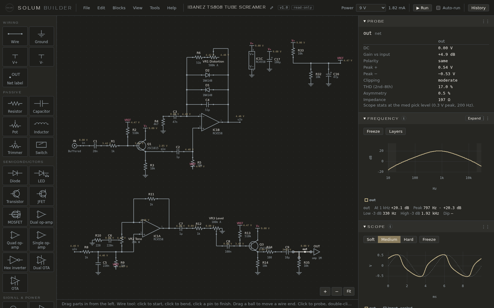
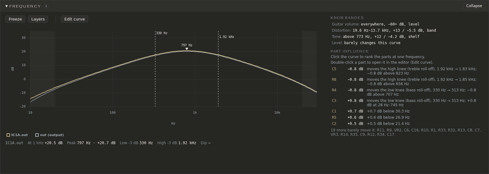
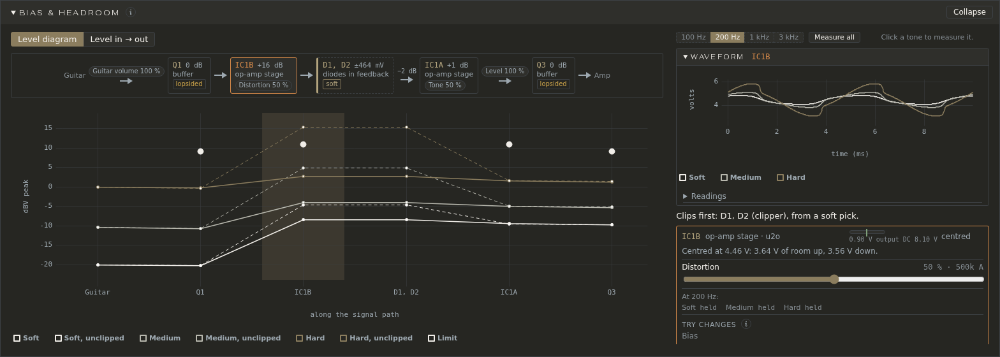
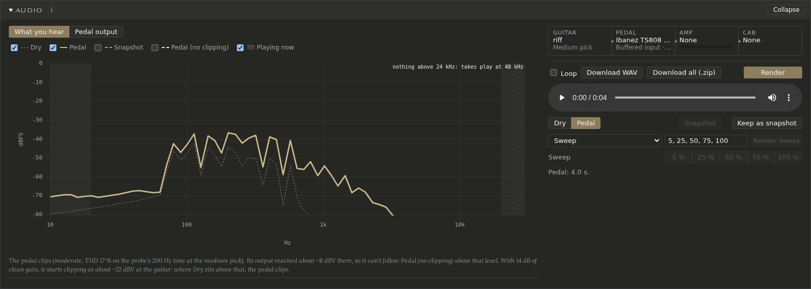

# Solum Builder

   
  <a href="https://solumfx.com">solumfx.com</a>

A circuit simulator for guitar-pedal builders that runs on your own computer. Draw a circuit, probe any point in it (waveform, harmonics, DC voltage), turn its knobs and watch the frequency curve follow, check it against plain-English rules, and hear it through an amp model.

It is for one person on one machine: no accounts, no cloud. Your circuits are plain JSON files in a folder you choose. It comes two ways: **a Mac app** (Apple Silicon), or **a Docker image** for any computer (Linux, Windows, an Intel Mac; x86-64 and ARM64).

Solum Builder is **source-available**: you may use it, change it and share it, but not sell it (see [Licence](#licence)). Pedal makers are welcome: designing, building and selling pedals with it is allowed.

- [A quick tour](#a-quick-tour)
- [Install and run](#install-and-run): [the Mac app](#the-mac-app) or [Docker](#docker-any-computer)
- [First steps](#first-steps)
- [Working on Solum Builder](#working-on-solum-builder): a pointer to the maintainers' guide
- [Licence](#licence)

## A quick tour

The picture at the top is the Ibanez TS808 Tube Screamer, one of the 19 starter circuits, after a run. The drawing shows the DC voltage at every node, and the panes on the right show the probed point (here the output): the **Probe** pane's readings (gain, peaks, clipping, distortion), the **Frequency** curve and the **Scope**'s waveform. Click any wire or part to probe it instead. Three panes open large for a closer look.

### Frequency

How much louder or quieter each frequency comes out at the probed point, from 10 Hz to 30 kHz, with its peak and corners marked. It follows the knobs as you turn them. **Knob ranges** says where each knob acts and by how much; **Part influence** ranks the parts by how much they move the curve, and what they move (*C5: the treble roll-off, 1.92 kHz → 1.83 kHz*). **Edit curve** lets you drag a corner or a peak and changes the parts to match. [More in the guide](docs/guide/frequency.md).

### Bias & headroom

Is each stage biased where it should be, which one clips first, and how hard do you have to play for it to happen? The signal path is drawn as a chain from guitar to amp, each stage with its gain. Below it, the level at every stage for a soft, medium and hard pick, against where each would clip. A stage's card shows its bias, its room to swing up and down, and its waveform, with a slider for each part that sets its gain and **Try changes** for values that centre the bias. [More in the guide](docs/guide/bias-and-headroom.md).

### Audio

Hear it: a guitar recording through the circuit, then through a NAM amp capture and a cab IR if you add them. Switch between **Dry**, **Pedal** and a kept **Snapshot** while it plays; the spectrum compares them, and the line under it says whether the pedal clips and from what level at the guitar. **Render sweep** renders a knob at several positions to compare. Nothing to listen to ships with the app: [Getting audio](docs/guide/getting-audio.md) says where to find a recording, amp captures and cab IRs.

## Install and run

Both run the same app, with the same simulator (ngspice 44.2, built the same way for each) and the same results. Pick the Mac app on an Apple Silicon Mac, Docker anywhere else.

### The Mac app

For a Mac with Apple Silicon (M1 or later) and macOS 14 or later. Intel Macs: use Docker.

1. Download `Solum Builder-<version>.dmg` from the [Releases](../../releases) page.
2. Open it and drag **Solum Builder** to **Applications**.
3. Open it from Applications. The first time, macOS says it can't check the app for malicious software. Open **System Settings → Privacy & Security**, scroll down to **Security**, and click **Open Anyway** next to *Solum Builder*; confirm. After that it opens with a double-click.

**Why macOS asks.** The app is signed by us, not by Apple: the project has no Apple Developer account, so the app isn't notarised and macOS doesn't know who made it. If you'd rather not trust a download, build the app yourself from this repository: on an Apple Silicon Mac with Xcode's command-line tools (`xcode-select --install`), run `make mac-app`. It fetches everything else into a build folder, runs the tests and writes the same `.dmg` into `dist/`; nothing is installed on your Mac. Details in [Building the Mac app](docs/maintain/mac-app.md).

Your circuits, blocks, models and audio go in `~/Library/Application Support/Solum Builder/` (**back this folder up**) and the cache in `~/Library/Caches/Solum Builder/`. **Solum Builder → Settings…** (Cmd-,) shows them, with **Show in Finder**, and **Change…** moves them elsewhere.

To update, download the new `.dmg` and drag the app to Applications again, replacing the old one; your files are kept. To remove it, drag the app to the Trash, and delete the two folders above if you don't want your files any more.

### Docker (any computer)

You need Docker (or Podman) with Compose, on an x86-64 (amd64) or ARM64 machine (a Raspberry Pi 5, an Apple Silicon Mac). With Podman, run `podman compose` in place of `docker compose`; it needs a compose provider installed (`podman-compose`, or Docker Compose).

    git clone <this repository>
    cd solum-builder
    docker compose up

Then open http://localhost:8000. The first `docker compose up` builds the image, which takes a few minutes.

It runs as it is: your circuits, blocks, models and audio files go in `data/` (**back this folder up**), and the search index and saved results in `cache/` (safe to delete at any time), both in the repo's folder. File → **Settings…** in the app shows where they are and sets how large the cache may grow.

To keep them elsewhere, or use another port, copy `.env.example` to `.env` and edit it:

- `DATA_DIR`: where your files go.
- `CACHE_DIR`: where the cache goes; keep it on a local disk.
- `PORT`: the port the app is served on (8000).

The repo comes with the two default folders, `data/` and `cache/`. If you point `DATA_DIR` or `CACHE_DIR` somewhere else, or start the image yourself with `podman run` or `docker run`, create the folders first (`mkdir -p /path/to/data /path/to/cache`): Podman stops with an error when a folder it should mount isn't there.

To update: `git pull`, then `docker compose up --build`. Your data folder is not touched. If the page looks wrong straight after an update, reload it once with Ctrl+Shift+R.

To run from source instead: Python 3.12 and your system's ngspice shared library (`libngspice`), then `pip install .` in a virtual environment and `solum serve`.

To run it on a NAS or another machine that doesn't build images, see [`docs/NAS.md`](docs/NAS.md).

## First steps

1. **Open a starter.** File → New from starter → *Ibanez TS808 Tube Screamer*. Starters are classic circuits, read-only; File → Save as makes a copy you can change.
2. **Run it.** Click Run (or tick Auto-run, and it runs after every change).
3. **Probe.** Click a wire or a part's pin. The panes on the right show that point: Scope (the waveform), Harmonics, DC, and Frequency (the curve from the input to there).
4. **Turn a knob.** In *Knobs & switches*, turn Distortion or Tone: the Frequency curve follows as you move it.
5. **Check it.** *Problems* lists what the rules found, each with why it matters and what to do.
6. **Hear it.** The Audio pane plays a guitar recording through the circuit and an amp model. No recordings or amp models come with the app: upload a clean guitar clip (WAV), a NAM amp capture (`.nam`) and, if the capture has no cabinet, a cabinet IR (WAV), then Render.

The guide is in the app under **Help → Documentation**, with a search; **Help → Formulas** has the sums builders need. The same pages are in [`docs/guide/`](docs/guide/README.md).

## Working on Solum Builder

Everything for people who work on the code is in **[Maintaining Solum Builder](docs/maintain/README.md)**:

- **[Setting up](docs/maintain/README.md#setting-up)**: the dev container (nothing installed on your machine), the pre-commit hook, and every `make` command with its settings.
- **[Tools](docs/maintain/README.md#the-solum-command)**: the `solum` command, benchmarks and profiling, and the scripts in `scripts/`.
- **[Tests](docs/maintain/README.md#tests)**: the test layers (unit, simulation, rules, parity, acceptance, browser) and when each runs.
- **[The project's documents](docs/maintain/README.md#the-projects-documents)**: the working agreement (`AGENTS.md`), the decisions log, the module map, the spec and the design, and how they're kept up to date.
- **[How-tos](docs/maintain/README.md#maintainers-how-tos)**: adding a model, a starter circuit or a block, updating the guide, releasing a version.
- **[Working with an AI agent](docs/maintain/README.md#working-with-an-ai-agent)**: what the agent reads, starting from a fresh clone, the two agent skills.

## Licence

MIT with the Commons Clause: see [`LICENSE`](LICENSE). In short, anyone may use, change and share Solum Builder; nobody may sell it, or a product or service whose value is mainly the app itself. Designing, building and selling pedals with it is allowed.

Fonts, the plotting library, makers' SPICE models and the sources the starter circuits follow keep their own terms: see [`THIRD-PARTY-NOTICES.md`](THIRD-PARTY-NOTICES.md).
