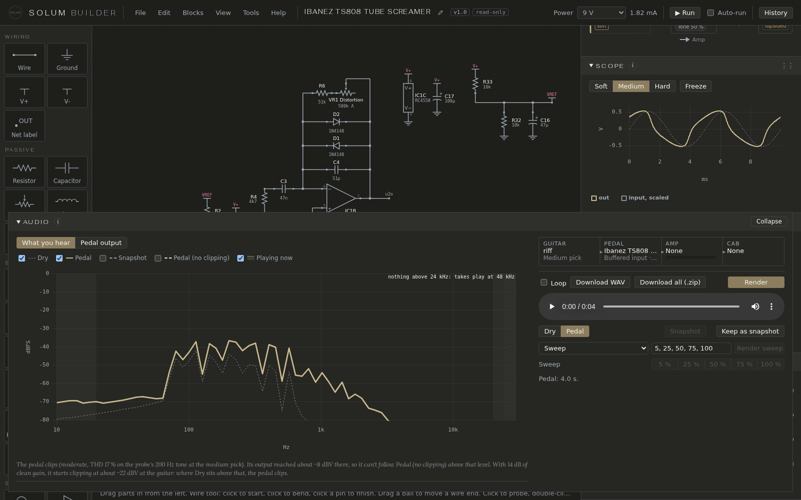

# Audio

The Audio pane plays a guitar recording through the circuit, then through an amp model and a speaker cabinet, so you can hear it. Nothing to listen to comes with the app: you upload your own recording, amp capture and cab IR. [Getting audio](getting-audio.md) says where to get them.

## The chain

Across the top, **Guitar ▸ Pedal ▸ Amp ▸ Cab**. Click one to open its drawer:

- **Guitar**: the **clip** (a DI recording: the guitar straight into an audio interface, as a WAV up to 10 s) and the **pick**, Soft, Medium or Hard. The clip's loudest moment is set to the pick's level at the guitar (0.1, 0.3 or 1 V peak), the same levels the Scope uses. **Upload…** adds a clip.
- **Pedal**: the circuit as its guitar input is set: the pickup, cable and volume pot are part of the circuit, loading its input as plugging in does. **Edit the guitar input…** opens the IN part's form. A circuit with a charge pump has **Charge pump switching** here: off, the pump gives its average voltage and renders are about ten times faster; on, it switches as the chip does, so you hear any whine its ripple leaks into the signal.
- **Amp**: the NAM amp capture (`.nam`), or None. **Input (pedal into amp)** is a trim between the pedal and the amp, like the NAM plugin's Input knob, from −40 to +20 dB: it changes how hard the amp is driven. Double-click it for 0 dB.
- **Cab**: the cabinet IR (a WAV under 2 s), or None. With a full-rig capture (amp and cab in one), leave Cab at None. With Amp at None, a take is the pedal's output alone.

Each drawer lists what you've uploaded, with each file's own sample rate. Uploads are kept in the data folder and stay on this machine.

For a fuzz, set the guitar input (in Pedal) to the pickup the clip was recorded with. A DI recording already carries its pickup's sound, so the render takes that pickup out of the clip first, and you hear how the fuzz loads the pickup rather than the pickup twice.

## Takes

**Render** makes the takes:

- **Pedal**: the clip played through the circuit, simulated in full, clipping and all, then the amp and cab.
- **Dry**: the clip without the pedal, through the same amp and cab, at the same level, so you compare like with like.
- **Keep as snapshot** holds a take as **Snapshot**, to compare against after a change.

Click **Dry**, **Pedal** or **Snapshot** to switch between them while it plays: switching keeps your place in the clip. **Loop** plays the clip round. **Download WAV** saves the take playing; **Download all (.zip)** saves every take, with the circuit each was rendered from and a note of its knobs, clip, amp and cab.

A render takes a while: the circuit is simulated sample by sample. While it runs, the button reads **Cancel render**; the takes already finished still play. Renders are kept, so playing one again, or changing only the amp or cab, costs much less.

**Render sweep** renders one knob at several positions, a take for each, played the same way: pick the knob in **Sweep**, type up to five positions in % (*5, 25, 50, 75, 100* to start), press Render sweep, then click a position's button to hear it.

A circuit with trimmers has a **Trimmers** fold: hear a trimmer at several positions as a sweep. Each position is checked first; one that saturates a stage is marked, since what you'd hear there is a broken bias, not a sound.

## How hard the amp is driven

The Amp chip has a gauge: how many dB the latest take is squashed by the amp. Under 1 dB reads **clean**, 1 to 6 **breaking up**, 6 to 15 **driven**, over 15 **saturated**.

It's measured by playing the take through the amp capture twice, as it is and 60 dB quieter. Any amp is clean that quiet, so the quiet copy gives the amp's clean gain. If the amp were clean at full level too, the full take would come out exactly 60 dB louder; however much it falls short is the squash (52 dB louder means 8 dB of squash). It's an average over the take, not note by note.

## The spectrum

**Spectrum** shows what each take holds, band by band (1/6 octave each), averaged over the clip. It has two views:

- **What you hear**: after the amp and cab, in **dBFS** (0 dBFS, the top, is the most a digital file can hold). The shaded area is what's playing now.
- **Pedal output**: before the amp, in **dBV** (0 dBV is 1 V), the voltage at the circuit's output.

The lines (tick or untick each above the chart):

- **Dry** and **Pedal**: the takes.
- **Snapshot**: the kept take, if any.
- **Pedal (no clipping)**: not a render but a calculation: Dry through the Frequency pane's curve at the knobs as they are now (it moves as you turn one). It's the pedal as if nothing in it clipped. Where Pedal sits **under** it, the pedal is clipping; where Pedal sits **above** it, the clipping has added harmonics where the clip had little. A clean circuit puts the two on top of each other. In What you hear it also leaves out the extra squash a louder pedal causes in the amp.
- **Clip levels** (in Pedal output, when the pedal clips): dashed lines at the level the output reached and where clipping starts at the guitar. A line under the spectrum says the same in words: *The pedal clips (moderate, THD 17 %…). With 14 dB of clean gain, it starts clipping at about −22 dBV at the guitar: where Dry sits above that, the pedal clips.*

Reading it:

- Everything in What you hear has been through the amp and cab, so every line falls off where the cab does (above about 5–6 kHz for a guitar speaker). Pedal output shows the pedal alone.
- A band sits well under 0 dBFS even when the take's peaks reach it, because each band is a slice of the sound averaged over the clip: a sine peaking at 0 dBFS reads −3 dB in its band.
- Unity gain isn't a line: it's the Pedal line sitting on Dry.
- Switching takes makes a click, which has energy at every frequency, so the shaded area jumps across the width for a moment.

## How a take is made

The clip's peak is set to the pick level, the pickup is taken out of it (see above), and ngspice plays it through the circuit at 96 kHz. The result is brought down to 48 kHz through a filter that is flat to 22.6 kHz and removes everything above 24 kHz (left in, it would fold back as false tones), then goes through the amp capture and the cab IR. A dry take skips the circuit.

Takes are written and played at 48 kHz, whatever the clip's or the capture's own rate, so nothing in What you hear goes past 24 kHz (hatched). In Pedal output, Pedal is read from the 96 kHz simulation and reaches 30 kHz; Dry and Pedal (no clipping) reach as high as the clip holds, half its sample rate.

The WAV is 32-bit float, so peaks past full scale are kept rather than clipped; the status line warns when a take's peaks go past 0 dBFS, since playback may clip.
