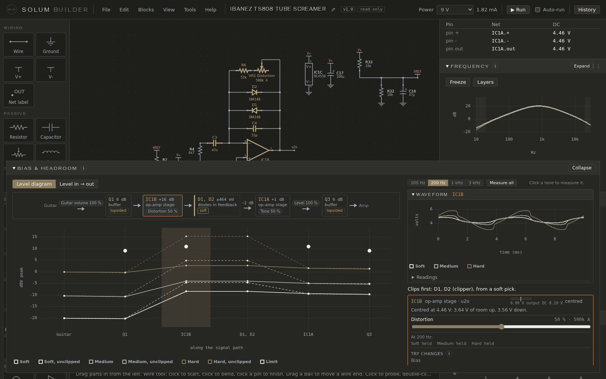
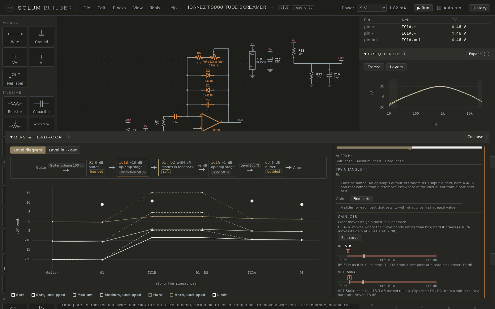

# Bias & headroom

This pane answers two questions about a circuit: is each stage biased where it should be, and which one clips first, and how hard you have to play for it to happen.

## The chain

The pane draws the signal's path as a chain of blocks, from **Guitar** to **Amp**, in the order the signal meets them.

- A **stage** is a part that amplifies or buffers: a transistor, a JFET, an op-amp. Its block shows its own gain at the test tone (*+16 dB*) and what kind of stage it is (*op-amp stage*, *buffer*, *gain stage*).
- A **clipper** is a set of diodes that limit the signal. Its block has a dashed outline and shows where it clamps (*±464 mV*) and its kind: **hard** (to ground), **soft** (in a stage's feedback) or **in series**. The kind is lit when it clips at a hard pick.
- A **double outline** is a discrete op-amp: several transistors working as one op-amp chip.

Between blocks, an **arrow** carries what the passive parts in between do to the signal at the tone: a tone stack, a volume pot, a filter. They aren't blocks because they have no gain of their own and can't clip; a tone stack can lose 15–20 dB, which the arrow shows (*−21 dB*). Losses under 1 dB aren't shown.

**Pots sit on the chain as chips**, where they act: *Distortion 50 %* on the stage whose gain it sets, *Volume 50 %* on the arrow it turns down. Hover a chip to see why it's there; click it to turn the knob right there (it's the same knob as in Knobs & switches).

A stage's marks say what happens at a hard pick:

- **clips**: the device runs out of room (a solid bar on the block's left);
- **lopsided**: its bias sits off centre, so one side clips first.

The top line names what clips first and from which pick: *Clips first: D1, D2 (clipper), from a soft pick.*

Hover a block to light its parts on the sheet; click it to keep them lit and open its card.

## Test tones and picks

Everything here is measured with a sine at the guitar input, at the three pick levels (Soft 0.1 V, Medium 0.3 V, Hard 1 V peak, as in [Probing](probing.md#the-test-signal)) and at one tone at a time: **100 Hz**, **200 Hz**, **1 kHz** or **3 kHz**. A circuit opens at 200 Hz; click another tone to measure it, or **Measure all**. One tone isn't enough because a circuit's gain changes with frequency: a treble booster gains far more at 3 kHz than at 100 Hz, so it clips from a softer pick there. With all four measured, the top line names the worst, and a block pushed hardest at another tone says so (*worst at 1 kHz*). A change measures the picked tone again.

Each run waits for the circuit to **settle**: it plays until each cycle repeats the last, like a pedal played for a moment rather than just switched on. A circuit still moving after 0.4 s says so.

The numbers are always the whole circuit's: each stage is measured in place, loaded by everything around it.

## A block's card

Click a block for its card:

- **The bar**: where the stage's output sits at rest between its limits, with how much room it has up and down (*Centred at 4.46 V: 3.64 V of room up, 3.56 V down*). An asterisk means the limit is an op-amp's rule-of-thumb swing, not a datasheet figure.
- **Each pick**: **spare** (how much louder it could get before it clips), **over** (how much room it lacks), **held** (diodes in its feedback stop it short of its limits) or **driven** for a clipper (how many dB it takes off).
- The pots that act on it.
- **Waveform**: the block's output at each pick, as a scope draws it: the last two cycles of the tone, time across in milliseconds, volts to ground up, so the wave rides on its DC bias.

The unclipped level is the signal reaching a stage times its small-signal gain: what it would put out if it had unlimited room.

## The large view

**Expand** opens two charts above the chain:

- **Level diagram**: the peak each pick reaches at each stage along the signal path, in dBV (0 dBV is 1 V peak). Solid lines are what it reaches; dashed lines are what it would reach if that stage didn't clip. The dots are each stage's limits: where a line meets one, that stage clips. A clipper to ground's limit is where it clamps.
- **Level in → out**: each stage's peak as the guitar gets louder, both in dBV, measured at levels from 3 mV to 3 V with the three picks marked. The dashed line is the guitar itself. Where a line bends flat, that stage is clipping: playing harder gets it no louder.

## Try changes

In the large view, a block's card has **Try changes**, to fix or reshape a stage and see the result before keeping it.

**Bias**, on a stage that sits high or low:

- **Centre** looks for one resistor next to the stage that centres it, from a tenth to ten times its value, rounded to a standard (E24) value.
- **Drag the mark** on the bar to aim the bias anywhere else (**Bias to…**): the same search, aimed there.
- A **trimmer** next to the stage comes first: it's turned, or given a target so it holds. One that already has a target (a JFET's drain) gets a new one.
- An op-amp stage biased from a reference elsewhere *can't be aimed*, and the card says why.

**Gain** (*Find parts*) finds the parts next to the stage that move its gain most, each tried 10 % up. Each resistor or pot gets a slider over its standard values (10 Ω to 10 MΩ; a pot's 1k to 1M), spread by the gain each value gives.

- The marks **S**, **M** and **H** are where something in the chain starts clipping at a soft, medium or hard pick. You can drag past them.
- While you drag, each value shows its gain and what clips first. That's an estimate from the small-signal gain and each stage's room; letting go tries it and measures it properly.
- A slider stops early before a value that would knock a stage out of its bias.
- A pot's slider changes its value (its range), not where it's turned.
- A capacitor moves where the curve bends more than the drive, so it opens **Edit curve** instead (see [Frequency and knobs](frequency.md#edit-curve)).

**Diodes**, on a clipper, measures each kind at a hard pick: silicon, germanium, Schottky, red LED, and one LED for a lopsided pair. A lopsided pair clips one side before the other, which adds even harmonics (a warmer, more amp-like sound). It also tries arrangements that add parts: each diode doubled (two in series clamp higher: louder and less squashed), one side doubled (2 + 1, lopsided), and on a clipper to ground a resistor in series (1k, 2k2, 4k7: a softer knee). An added part goes beside the diode; if there's no room, the parts beyond are moved out of the way first, and the option says so.

Each option says what else moves. **Try** puts an option in and measures again; another option in the same box takes its place. Try as many blocks as you like:

- **Changed** lists everything in; **↺** puts one part back.
- The charts show the chain as it was, faint; **Before** turns that off.
- **Keep changes** leaves them in, as one step in History; **Discard changes** puts everything back as it was.

## A trimmer with a target

A trimmer can hold a voltage instead of sitting at a rotation: the way you bias a JFET or a germanium transistor on the bench, by turning a trimmer until the meter reads the target. Give it one with **Drain target** in a JFET's or MOSFET's form (pick the **Bias trimmer**), or with **Bias to…** here. The app turns the trimmer to the target on Apply and again on every run, so it keeps holding as you change other parts or swap the transistor. If the target can't be reached, Problems says so.

To turn it by hand again, remove the target in its form.
