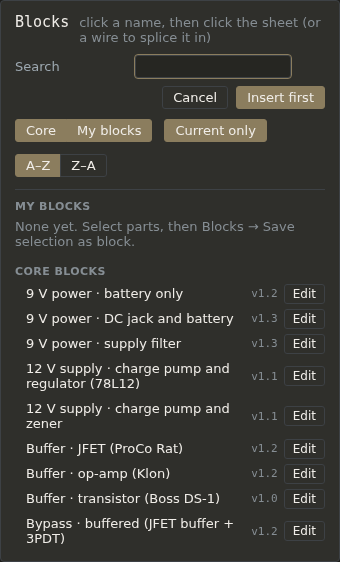

# Blocks

A block is a piece of circuit you can drop into any sheet: a gain stage, a tone stack, a bypass switch, a power supply. The app comes with a catalogue of **core blocks**, each from a published circuit and cited in its description, and you can save your own.

## Inserting a block

Blocks → **Insert or manage blocks…** (or press B). Click a block's name (Enter, **Insert first**, takes the first one listed), then:

- **click a wire** to splice it in: the wire is cut and the block's input and output take its two ends (see [Your first pedal](first-pedal.md#3-drop-in-a-gain-stage));
- or **click an empty spot**: the block lands there, its ports drawn as net labels (`in`, `out`) for you to wire.

The block's parts are renumbered so nothing clashes with the sheet, and they arrive selected, so you can drag them into place at once. Its supplies and ground join the sheet's by name. Its description arrives as a note (*From block: …*) and its part notes come with it: see [Notes](notes.md).

A drop never shorts anything: if the block would land with two of its own nets joined through a sheet wire, a supply or ground on a signal net, or one of its wires lying along a sheet wire, it moves to a clear spot instead.

A block is a plain copy. Nothing links it back to the catalogue, so changing a block later never changes circuits it was dropped into.

The dialog has a **Search** box (by name, tag or part model), **Core** and **My blocks** to show either list, **Current only** to hide older versions, and **A–Z** / **Z–A**. Core block names say what then how: *Tone stack · Fender TMB*, *Buffer · JFET (ProCo Rat)*, *Charge pump · doubler, chip (TC1044S)*.

## The core blocks

They come in these families: 9 V power (battery, DC jack and battery, supply filter); 12 V supplies; buffers (JFET, op-amp, transistor); bypass (true, buffered, the Klon's); charge pumps (doublers and inverters, with a chip or an op-amp); a diode clipper; gain stages (op-amp, JFET, Big Muff transistor); tone stacks (two Baxandalls, the Big Muff's, the Fender TMB); the Tube Screamer's clipper and tone; the Rat's distortion stage; the Rangemaster treble booster; and a half-supply reference divider. Each one's description says where it comes from and what to set.

## Saving your own

Select the parts (Shift+drag a box), then Blocks → **Save selection as block…**; with nothing selected it reads **Save sheet as block…** and takes the whole sheet. IN and OUT are always left out.

- **Name** and **Description**.
- **Ports**: click a wire or a pin on the sheet for each connection the block has to the outside (`in`, `out`, `vref`…), and name it. Supplies and ground connect by themselves.

Your blocks are listed under **My blocks**, with their version. A name you already have asks before replacing it; a final version can't be replaced.

## Editing a block

**Edit** beside a block opens it on the sheet like a circuit. On one of yours, Save keeps the changes (its version counts on). A core block can't be changed: Edit opens a copy, and Save puts it in My blocks, leaving the core one as it is. **Delete** removes one of your blocks' versions; circuits you dropped it into keep their parts.

File → **Properties…** and **New major version…** work on a block as on a circuit: see [Files and versions](files-and-versions.md).
