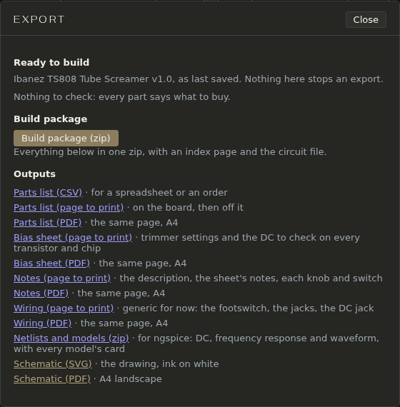

# Export and build

When a circuit is ready to build, File → **Export…** makes everything you need at the bench from it. Export works from the **last save**: save first to include your latest changes.

## Ready to build

The top of the window checks the saved circuit for anything that stops you buying or building it: changes since the last save, a circuit that doesn't simulate (then there's no bias sheet), and each build check not dismissed, errors first: a capacitor with no kind, an electrolytic with no voltage rating, a part with no package, no enclosure chosen. Click a row to close the window and select that part. Nothing here stops an export; *Nothing to check: every part says what to buy* means it's all there.

## The outputs

- **Build package (zip)**: everything below in one zip, with an index page and the circuit file. Open `index.html` in it first.
- **Parts list**: as CSV for a spreadsheet or an order, as a page to print, or as an A4 PDF. Identical parts are grouped on one line (quantity, part, value, details, refs), the parts that go on the board first, then the ones off it: jacks, the DC jack, switches, pots, the battery and the status LED.
- **Bias sheet**: the trimmer settings and the DC voltages to check on every transistor and chip once it's built, with your meter.
- **Notes**: the description, the circuit's notes, and each knob and switch.
- **Wiring**: the footswitch, the jacks and the DC jack. It's generic for now, not drawn from the circuit.
- **Netlists and models (zip)**: the circuit as ngspice netlists (DC, frequency response and waveform) with every model's card, to run outside the app.
- **Schematic**: the drawing, ink on white, as SVG or as an A4 landscape PDF.

A "page to print" opens in a new tab: print it from the browser.

## Before export: the enclosure and capacitor kinds

The parts list can only name what the circuit says. Set the enclosure in File → **Properties…**, each capacitor's kind and rating in its form (Help → **Choosing capacitors…** says which goes where; View → **Capacitor types** shows them all on the sheet), and a label on each pot and switch, which names its knob.
