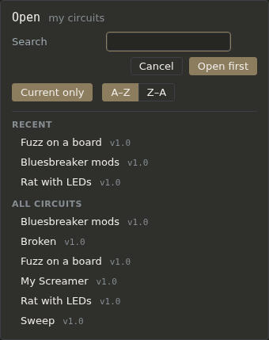

# Files and versions

Your circuits and blocks are plain JSON files in the app's data folder (`DATA_DIR`; see the README). Nothing is saved until you save it: the chip after the name says **Not saved** while there are changes to keep, or **Never saved** for a sheet that has no file yet, and the browser tab's title starts with •. Back the data folder up.

## The File menu

- **New sheet**: an empty sheet with the guitar input and the amp.
- **New from starter**: one of the classic circuits that come with the app (read-only).
- **Open…**: your circuits. See [Opening a circuit](#opening-a-circuit).
- **Save** (Ctrl+S): saves over the open file. A new sheet, a starter or a read-only file asks for a name instead.
- **Save as…**: a copy under a new name, in My circuits.
- **Properties…**: the name, tags, description and enclosure, with the file's details.
- **New major version…**: keeps the current version as final and carries on with the next.
- **Export…**: the parts list and build package. See [Export and build](export.md).
- **Delete this circuit…**: removes this version's file, after asking. It can't be undone; other versions stay.

Opening something else, or closing the tab, with unsaved changes asks first: **Save**, **Don't Save** or **Cancel**.

## Renaming

Click the **pencil** after the name in the header. The name becomes a box and the pencil a tick: type the new name, then press Enter or click the tick. Esc, or a click elsewhere, puts the old name back. A name that's empty or already taken is said under the box.

For a saved circuit the file is renamed at once, every version's file with it; changes you haven't saved stay unsaved. A starter, a core block or a final version can't be renamed, and the app says why.

## Opening a circuit

File → **Open…** lists your circuits in two sections: **Recent** (the last three saved) and **All circuits**. Type in **Search** to find one by name, tag or part model: only the matches show. **Current only** hides older versions (switch it off to see them); **A–Z** and **Z–A** sort All circuits. Click a circuit to open it; Enter (**Open first**) opens the first one listed.

## Versions

Every file has a version, shown after its name: *v1.0*, *v1.12*.

- Each save that changes something counts the minor number on: v1.0, v1.1, v1.2… A save with no changes leaves the file alone.
- **New major version…** keeps the saved version as **final** (read-only) and carries on in a new file at v2.0, under the same name. Each major version is its own file (`my-boost-v1.json`, `my-boost-v2.json`); older ones show in Open when *Current only* is off. Unsaved changes are asked about first, so what's kept is what's on disk.
- **Mark as final**, in Properties, makes the current version read-only without starting a new one. **Unlock** (asked first) makes it editable again; its version counts on from where it was.

Starters and core blocks are always read-only: Save on one asks for a name and makes your own copy.

## Properties

File → **Properties…** has:

- **Name**, **Tags** (comma-separated, for search) and **Description**: an edit, saved with Save.
- **Enclosure**: one of the standard boxes (1590A, 1590B, 125B, 1590BB, 1590XX) or a custom size, for the parts list.
- The file's details: its kind, where it is (`<data>/circuits/…`), its version, when it was last saved and whether it can be changed, with **Mark as final** or **Unlock**.

## Undo and History

Every edit is a step: Ctrl+Z undoes one, Ctrl+Shift+Z redoes one. **History**, in the header, lists every step since the circuit opened, newest first; click one to go back (or forward) to it. History starts again when you open a circuit, and saving doesn't clear it.

Turning a knob or flipping a switch isn't a step, and doesn't make the circuit *Not saved*. See [Frequency and knobs](frequency.md).
