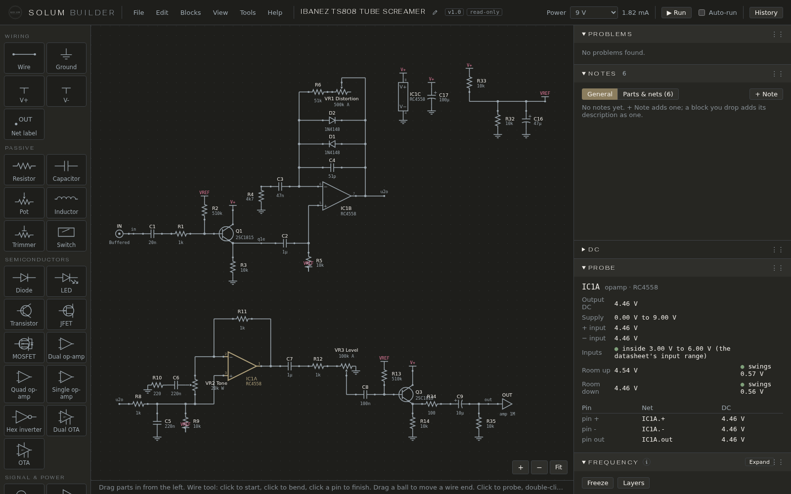
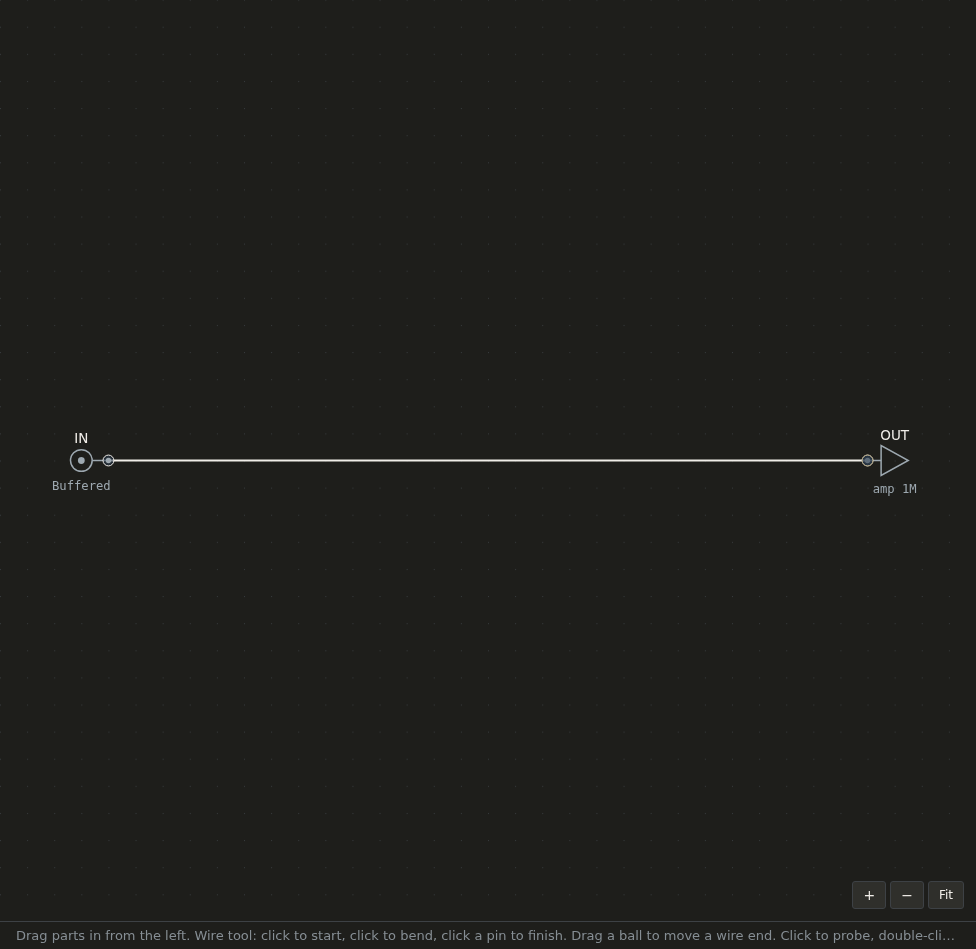
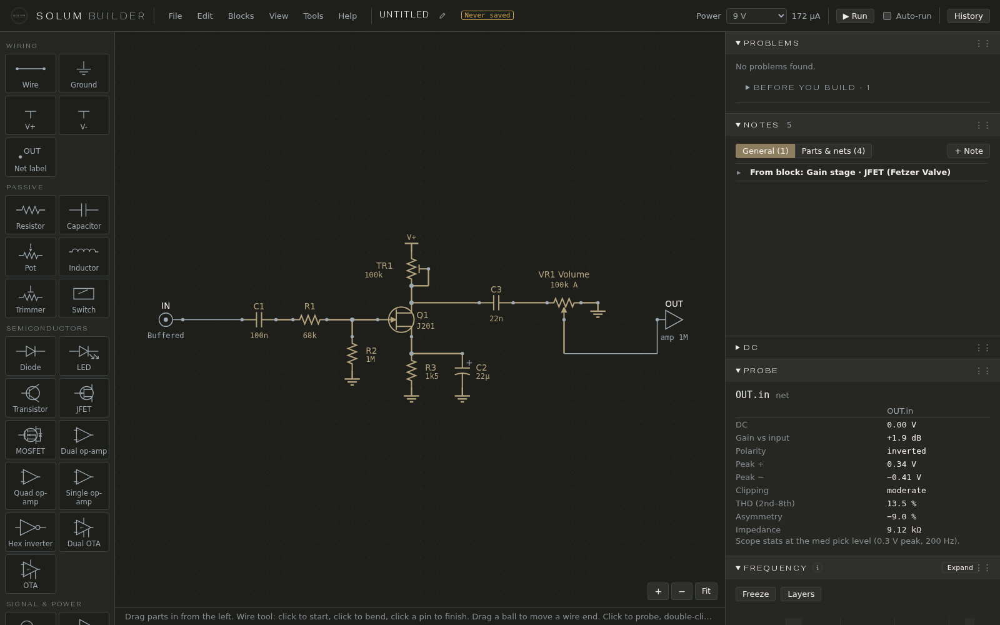

# Your first pedal

This page takes you from an empty sheet to a working one-knob JFET boost in about ten minutes, and shows the main parts of the screen on the way. Nothing here needs a guitar or an amp model.

## The screen

- **The header**, left to right: the menus (File, Edit, Blocks, View, Tools, Help), the circuit's name with a pencil to rename it, a chip saying *Not saved* or *Never saved* when there are changes to keep, the **Power** supply, **▶ Run** with its **Auto-run** switch, and **History**.
- **The parts palette**, on the left: every part you can place, in groups (Wiring, Passive, Semiconductors, Signal & power, Misc). Hover a tile to see its key: R for a resistor, C for a capacitor, and so on.
- **The sheet**, in the middle, where you draw. The +, − and Fit buttons are at its bottom right; the line under it says what a click does.
- **The panes**, on the right: Problems, Notes, DC, Probe, Frequency, Bias & headroom, Scope, Harmonics, Knobs & switches and Audio. Click a pane's title to fold it; drag its grip (⋮⋮) to move it. View → Reset pane order puts them back; File → Settings… picks the theme: Solum, Dark or Light. A pane with an **ⓘ** says what it shows and how to read it; a pane with **Expand** opens a large view over the sheet.

## 1. A new sheet

File → **New sheet**. Every circuit starts with two parts that can't be deleted: **IN**, the guitar input, and **OUT**, the amp's input. The simulation always plays from IN to OUT.

## 2. Wire the guitar to the amp

Click the **Wire** tile (or press W), click the end of IN's pin, then the end of OUT's pin. A wire joins them. Press Esc to put the Wire tool down.

## 3. Drop in a gain stage

Blocks → **Insert or manage blocks…** (or press B). Click **Gain stage · JFET (Fetzer Valve)**, then click on the wire. The block is spliced into it: IN now feeds the block's input and its output feeds OUT. Its parts are renumbered so they don't clash with anything on the sheet, and its description arrives in the Notes pane.

The block is Run Off Groove's Fetzer Valve: a J201 JFET with a trimmer (TR1) as its drain resistor and a Volume pot on its output.

## 4. Run it

Press **▶ Run** (or Ctrl+Enter). Turn on **Auto-run** to have it run after every change as you draw; the app remembers the switch.

After the run:

- **Power** shows the current the circuit draws from the supply (about 170 µA here).
- **Problems** says *No problems found*, with one note under *Before you build*: *No enclosure chosen*, which only matters for the parts list. See [Problems](problems.md).
- **Bias & headroom** shows the signal's path as a chain of blocks: *Guitar ▸ Q1 (+25 dB, gain stage) ▸ Volume 50 % ▸ Amp*, and says what clips first. See [Bias & headroom](bias-and-headroom.md).

## 5. Probe it

Click the wire going into OUT. **Probe** shows that point's DC voltage, its gain against the guitar, its peaks and how much it clips; **Scope** draws its waveform; **Harmonics** shows the overtones the stage adds; **Frequency** draws its curve across the audio band. Click Q1 itself and Probe shows the transistor's working point instead. See [Probing](probing.md).

TR1 has a *bias target*: the app turns it for you so Q1's drain sits at 4.5 V, the way you would set it on the bench with a meter. Open **DC**: it says *TR1 solved to 26 % for its bias target*, lists every net's voltage, and Q1.D (the drain) reads 4.50 V.

## 6. Turn the knob

In **Knobs & switches**, drag **Volume**. The Frequency curve follows as you drag, and the circuit runs again in full as soon as you pause. Turning a knob isn't an edit: it changes what you see and hear, not the circuit. **Use as opening positions** saves where the knobs are now as where they start when the circuit opens.

## 7. Save it

File → **Save** (Ctrl+S) asks for a name the first time. The name then shows in the header with the version, *v1.0*. See [Files and versions](files-and-versions.md).

## Starting from a classic circuit instead

File → **New from starter** lists the classic pedals that come with the app: the Tube Screamer, Big Muff, Fuzz Face, Rat, Klon, Blues Driver and others, some in two versions (the original, and Aion FX's build of it). Starters are read-only; File → **Save as…** makes a copy you can change. Each starter's notes (in the Notes pane) explain its parts and suggest things to try.

## Where next

- [Drawing](drawing.md): parts, wires, labels and the edit forms.
- [Probing](probing.md): Probe, Scope, Harmonics and DC.
- [Frequency and knobs](frequency.md): the live curve, layers, Edit curve and trying several values.
- [Audio](audio.md): hearing the circuit through an amp model.
