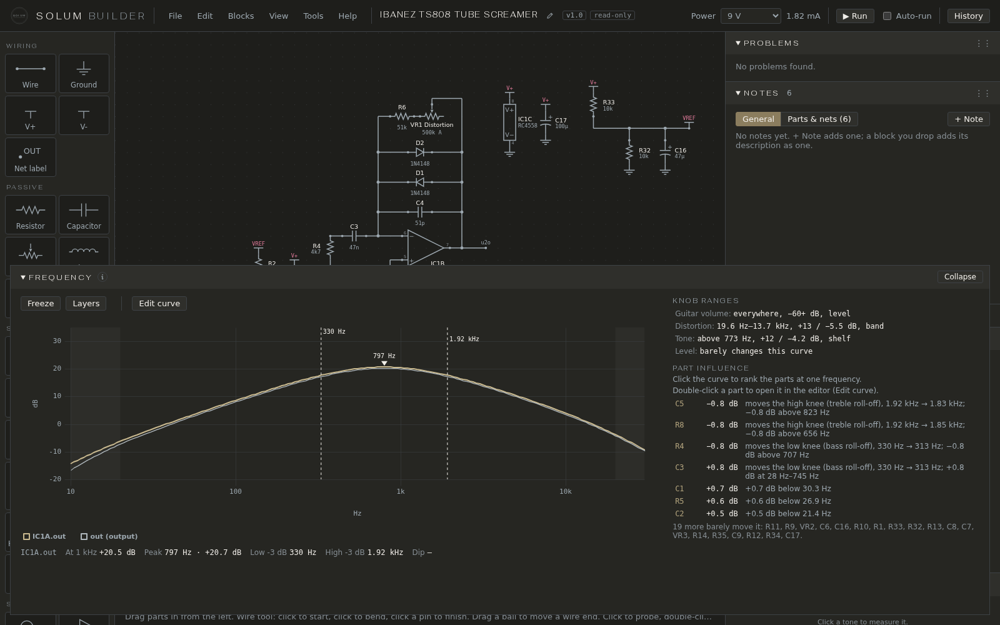
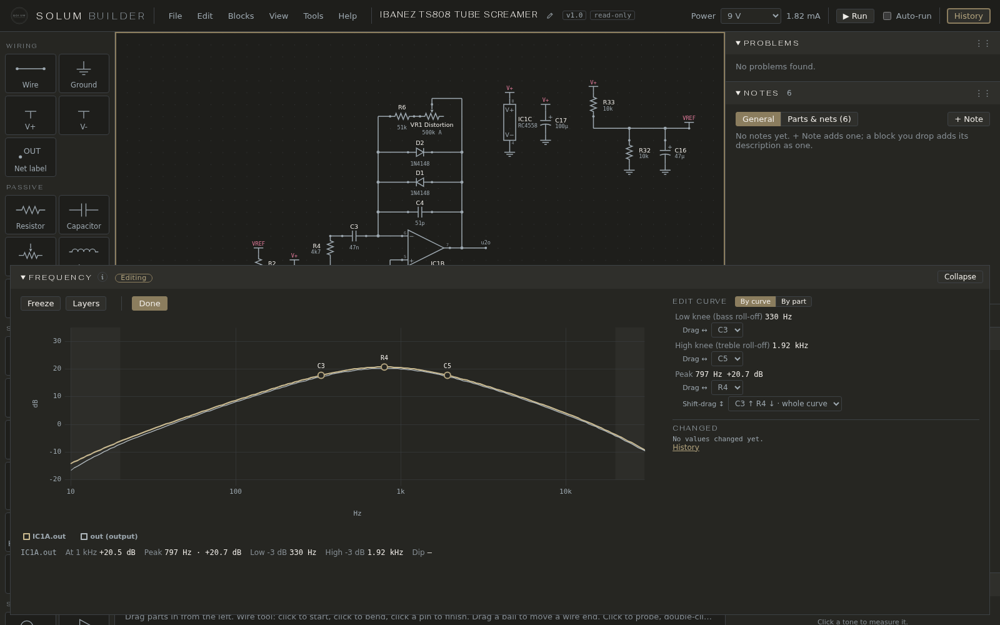
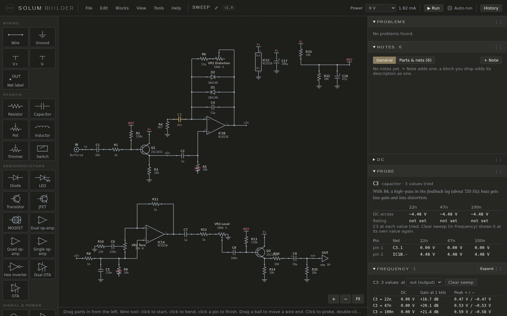

# Frequency and knobs

## The Frequency pane

The curve shows how much louder or quieter each frequency is at the probed point than at the guitar, in dB, with the knobs where they are now. It's the small-signal curve: what the circuit does to a quiet signal, before anything clips (the Scope and the Audio pane show clipping). Below 20 Hz and above 20 kHz, outside hearing, is shaded.

The output is always drawn; the probed point is drawn with it. Under the curve, its readings:

- **At 1 kHz**: the gain there.
- **Peak**: the highest point and its frequency.
- **Low −3 dB** and **High −3 dB**: where the curve has fallen 3 dB below its peak, on each side: the bass and treble corners of a simple band. On a curve with more than one bump these are "3 dB below the peak", not corners.
- **Dip**: the lowest point between two rises, if there is one (a mid scoop).

Probe a capacitor and the curve is drawn on each side of it, so you can see what it filters.

**Freeze** keeps a copy of the curve to compare against the next change; **Clear snapshot** removes it.

## Knobs & switches

Every pot and switch in the circuit gets a control here, named by its label ("Distortion", "Bypass mode"). The guitar's volume, from the IN part, is a knob too.

- **Drag a knob**: the Frequency curve follows as you drag, solved in the browser, and the circuit runs again in full as soon as you pause: Probe, Scope and Bias & headroom follow. A take in the Audio pane is marked out of date until you render again.
- **Click a switch position**: the circuit runs again in that position. Hover a position to see what it joins (*1: A2–A1, B2–B1*).

Turning a knob or flipping a switch isn't an edit: there's nothing to save or undo, and the circuit opens next time where it was saved. **Use as opening positions**, under the knobs, makes where they are now the circuit's own, as one edit.

A switch's position names (Vintage, Thick) come from its form. A DC jack and a battery add a **Power** switch (DC jack or Battery), and a stereo input jack with a battery adds a **Cable** switch: see [Power](power.md).

## The large view

**Expand**, on the pane's title, opens the Frequency pane over the sheet, with room for the layers. **Collapse** puts it back; Esc shrinks it to a bar at the bottom of the sheet.

## Layers

**Layers** adds marks and lists over the curve. The pane and its large view each remember their own.

- **Knees**: a dashed line at each corner frequency.
- **Peaks and dips**: a marker on each, with its frequency and level.
- **Knob ranges**: each knob turned end to end, and where it acts: *Tone: above 773 Hz, +12 / −4.2 dB, shelf*; *Distortion: 19.6 Hz–13.7 kHz, +13 / −5.5 dB, band*; *Level: barely changes this curve*. Turning a knob shades the band it acts on.
- **Part influence**: every part's value raised 10 %, ranked by how much it moves this curve, with what it moves (*moves the high knee (treble roll-off), 1.92 kHz → 1.83 kHz*). Click the curve to rank the parts at one frequency instead. Double-click a part in the list to change it in Edit curve.

Part influence is small-signal only: it shows filtering, not clipping. The live solver holds each stage's bias fixed, so a part tagged **sets bias** shows only its filtering here; for everything it does, use [Try several values](#trying-several-values) from its form, or [Bias & headroom](bias-and-headroom.md).

## Edit curve

In the large view, **Edit curve** lets you change the parts by moving the curve itself.

**By curve**: each knee, peak and dip has a dot naming the part that moves it.

- **Drag a dot sideways** to move that knee or peak: it changes the part its row names (*Drag ↔*).
- **Shift+drag** moves a peak or dip up or down instead: it changes the parts in its *Shift-drag ↕* list together, each the way its arrow shows to raise it (the other way to lower it), so the peak keeps its place.
- Letting go applies the values and runs again. The faint line and dots are the curve as it was when you pressed Edit curve.
- A **double ring** is two handles close together (within 1/6 octave) sharing one dot: its label names both; a plain drag takes the one picked in the list, Shift+drag the one that can go up or down.
- A **faint dot** has nothing to move it that way.
- A knee is a handle only while the curve is a simple band. If a second bump appears, that point is a −3 dB point and not a corner, and its row says *not a corner now*. A peak that moves more than 1/3 octave on a curve with two or more peaks can be lost track of; its row says *lost*.
- **Whole curve** marks a part that changes the level an octave or more away about as much as at the peak: it acts like gain, raising everything, rather than making the peak stand out.

**By part**: the parts ranked by how much +10 % moves the curve. Click one to slide its value; letting go applies it.

Knobs and parts that set a bias are left out (Knob ranges and Try several values are for those). Changing the parts around a knob changes what the knob does over its whole turn, not just where it is now. On a drive or fuzz, raising a peak before the clipping means more gain into it: more clipping, not only louder.

Under the rows, **Changed** lists every part you've changed, with what it was; **↺** puts one back. **Keep changes** leaves the new values in (one step in History); **Discard changes** puts every value back. Until you choose, the view stays open.

## Trying several values

Every part form with a value or a model has a box at the bottom: *Compare resistances, overlaid on the plots (up to 5)*. Type up to five values (`22n, 47n, 100n`) or pick models, and press **Try**.

Each value is a full simulation, bias and all, so this is the way to see what a part that sets a bias really does. The Frequency and Scope panes draw one line per value; the pane's title says what is compared (*C3: 3 values*), **at** picks which net to show, and a table gives each value's DC, gain at 1 kHz and peaks. The Probe pane shows the part itself at each value, a column per value: a resistor's current and power, a transistor's voltages. Layers and Edit curve are off while a comparison is shown. **Clear sweep** ends it. The part's own value doesn't change.

Power → Custom… does the same for the supply voltage: *Compare supply voltages, overlaid on the plots (up to 5)*.
