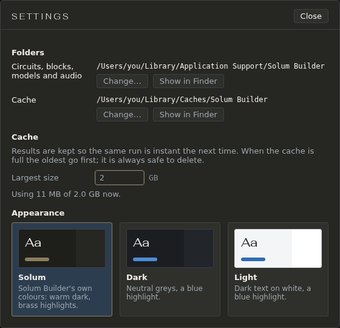

# The Mac app

The Mac app is the same Solum Builder as the Docker version, in a window of its own: the same simulator, the same results, the same files. It needs an Apple Silicon Mac (M1 or later) and macOS 14 or later; nothing else needs to be installed.

## Installing

Download `Solum-Builder-<version>.dmg` from the project's Releases page on GitHub, open it and drag **Solum Builder** to **Applications**. The first time you open it, macOS says it can't check the app for malicious software: open **System Settings → Privacy & Security**, scroll down to **Security**, click **Open Anyway** next to *Solum Builder*, and confirm. After that it opens with a double-click. Why macOS asks is below, in [Why macOS asks](#why-macos-asks).

## How it differs from the Docker version

The same: the simulator (ngspice 44.2, built the same way for both), every result, the starters, blocks and models, the guide, and the circuit files themselves. A circuit saved in one opens in the other: copy it into the other's circuits folder, or use File → **Import…**.

Different:

| | Mac app | Docker version |
|---|---|---|
| Runs on | An Apple Silicon Mac, macOS 14 or later | Any computer with Docker or Podman: Linux, Windows, an Intel Mac, a NAS (x86-64 or ARM64) |
| Opens in | Its own window, from Applications or the Dock | A browser tab, at `http://localhost:8000` |
| Reached from | This Mac only | Any device that can reach the machine it runs on, if you open its port (a NAS, a home server) |
| Installed by | Dragging the app from the `.dmg` | `git clone` and `docker compose up`, which builds the image |
| Updated by | Replacing the app with the new one | `git pull`, then `docker compose up --build` |
| Your files | `~/Library/Application Support/Solum Builder/`, moved with **Change…** in Settings | `data/` in the app's folder, moved by setting `DATA_DIR` in `.env` and restarting |
| Downloads | Ask where to save | Go where the browser puts downloads |
| Links to other sites | Open in your default browser | Open in a new tab |
| Small things remembered (pane scroll, list or grid views, the Audio pane's picks) | Until you quit | Kept by the browser |

Preferences (theme, Auto-run, which panes are open and their order) are kept with your files in both, so they survive a quit. See [What the app remembers](settings.md#what-the-app-remembers).

## Why macOS asks

macOS checks every app downloaded from the internet for two things: that it's signed with a certificate Apple issued to a known developer, and that Apple has scanned it (notarised it). Solum Builder has neither: the project has no Apple Developer account, which costs a yearly fee. The app is signed, but by the build itself, not with a certificate from Apple (Apple Silicon Macs run nothing unsigned). So macOS can't say who made it, and asks you to decide.

What this means for you:

- The first time, and again after each update, open it with **Open Anyway** as above. Only the first open of each version asks.
- macOS doesn't stop the app doing anything once it's open: it runs like any other app. It needs no special permissions, and its window and server stay on your Mac (nothing listens on the network).
- If you'd rather check before trusting it, each release has the `.dmg`'s SHA-256 checksum and a record, kept by GitHub, that it was built by the project's release workflow from the tagged source. The README's *Checking the download* says how to check both.
- Or build the app yourself from the source: on an Apple Silicon Mac with Xcode's command-line tools, `make mac-app` makes the same `.dmg`. An app you built on your own Mac opens without asking.

If the project gets a Developer ID one day, releases will be signed and notarised and open with a double-click; nothing else about the app changes.

## The window and the menu bar

All of the app is in its window, with its own menus (File, Edit, View and the rest) at the top of the page. The Mac menu bar adds **Solum Builder → Settings…** (Cmd-,), the same window as File → **Settings…**, and **Quit Solum Builder** (Cmd-Q).

Closing the window quits the app. If a circuit has unsaved changes, it asks first (**Cancel** or **Quit Anyway**). Opening the app while it's already open brings its window forward; there is only ever one copy.

Links to other websites, and the guide's pop-out icon, open in your default browser. Downloads (a WAV, the build package) ask where to save them.

## Where your files are

Circuits, blocks, models and audio are in `~/Library/Application Support/Solum Builder/`, and the cache in `~/Library/Caches/Solum Builder/`. To see `~/Library` in the Finder, hold Option and open the **Go** menu, or use **Show in Finder** in Settings.

**Change…** moves either folder elsewhere, for example to Documents. See [Settings](settings.md) for what moving does. Back up the circuits folder; Time Machine does, unless you've left it out.

**Moving to a new Mac**: Migration Assistant brings everything across. Or copy `~/Library/Application Support/Solum Builder/` to the same place on the new Mac, before opening the app there for the first time. If you moved the circuits folder somewhere else, copy that folder too. The cache isn't needed: the app makes a new one.

## Updating

Download the new `.dmg` and drag the app to Applications again, replacing the old one. Your files stay where they are. macOS asks for **Open Anyway** again for each new version.

## Removing it

Drag **Solum Builder** from Applications to the Trash. Your files stay unless you delete them too: `~/Library/Application Support/Solum Builder/` (your circuits: keep a copy if you might want them), `~/Library/Caches/Solum Builder/` and the log folder, `~/Library/Logs/Solum Builder/`. If you moved a folder in Settings, it's where you moved it.

## If it doesn't start

The window says *Solum Builder couldn't start*, with the reason and where the log is: `~/Library/Logs/Solum Builder/solum.log`. Quit (Cmd-Q) and open it again. If it keeps happening, send that file with your report.
