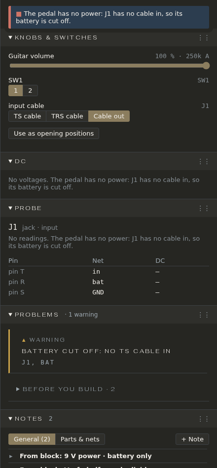

# Power

A pedal's power starts at the adapter's DC plug: mains is never simulated. There are four power parts, and most circuits need none of them.

## The Power menu

**Power**, in the header, is the supply plugged into the pedal: 9 V, 12 V, 18 V, ±9 V, ±12 V or ±15 V, or **Custom…** for any other. It always sets **V+** (and **V−** on a ± supply): every V+ bar on the sheet is that supply. It's ideal and perfectly clean.

**Custom…** sets the type, **+** (for most pedals: NPN transistors, op-amps), **−** (for PNP circuits like the Fuzz Face, which run from −9 V) or **±** (a split supply), and the voltage of each side. Its **Compare supply voltages** box runs the circuit at up to five voltages, overlaid on the plots: does it still work on a flat battery, how much more headroom at 18 V?

Beside the menu, after a run, is the current the circuit draws from the supply (*1.82 mA*): what to size a battery or an adapter by.

18 V or −9 V made *inside* the pedal from a 9 V supply is a charge pump's job, on its own net: see [Charge pumps and regulators](#charge-pumps-and-regulators).

## Which parts to draw

| You want to… | Draw |
|---|---|
| just power the circuit | nothing: the Power menu does it |
| draw the power section, for a full drawing and the parts list | a **DC jack** |
| run it from a battery, or switch between plugged in and battery | a **DC jack** and a **battery** (the *9 V power · DC jack and battery* block) |
| switch the battery off when the guitar cable comes out, as pedals do | a **battery** with its − on a TRS input **Jack**'s ring (the *… switched by the input jack* blocks), or on a TRS **IN**'s own ring: see [Jacks and cables](#jacks-and-cables) |
| hold another net at a voltage of its own | a **DC source** |

### DC jack

The DC jack draws the real jack: its sleeve **+** wired to V+, its centre **−** to ground (centre negative, as pedal supplies are), and its battery lug. It makes no voltage of its own: the Power menu's supply comes in through it. It's there for a full drawing, the parts list and export. There's one per circuit, always called DC.

Once it's drawn, the adapter's plug counts, as on a real pedal: Knobs & switches always has its **Power** switch.

- **With no battery**: **Plugged in** or **Unplugged**. Unplugged, the Power menu's rails (V+, and V− too) carry nothing and the pedal has no power (*The pedal has no power: DC has no plug in.*, see [No power](#no-power)).
- **With a battery on its lug**: **DC jack** (a plug in: the Power menu's supply powers the pedal and the battery is cut off) or **Battery** (no plug: the battery lug touches the sleeve and the battery powers it).

A chip left of the Power menu says which: *DC jack*, *DC jack · unplugged*, or *Battery · 7.4 V* with the menu greyed (*Battery · cut off* while a cable out switches it off).

With a DC plug in, the input jack's cable doesn't matter to the power: the supply powers the pedal whether or not the battery is switched on. Pull the DC plug (**Battery**) and the battery is on only while a TS cable is in the input jack, if its − goes to the jack's ring.

### Battery

A 9 V battery, its voltage picked by how used it is (from Energizer's 522 datasheet, on a pedal's load): **Fresh (9 V)**, **Half used (7.4 V)**, **Low (6.6 V)**, **Nearly flat (5.5 V)**, or your own measured voltage. An internal resistance is optional; measure it as the drop in volts on a known load, divided by the current.

Where its **+** goes decides what it powers:

- **On V+, no DC jack drawn**: it powers the pedal, and the Power menu is greyed.
- **On the DC jack's battery lug** (the jack's + on V+): it powers the pedal while no plug is in; plug one in (Knobs → Power) and the Power menu's supply takes over, the battery cut off. This is how pedals are wired.
- **On V+ beside a DC jack**: unplugged, it powers the pedal; plugged in, it stays connected beside the supply. It then needs an internal resistance for the circuit to run, and Problems warns that the jack doesn't switch it.
- **On any other net**: it powers only what's on that net, and the Power menu keeps V+.

Its **−** goes to ground, so it's always on, or to a TRS input jack's ring, so that plugging a guitar cable in switches it on: a TS plug's long sleeve joins the ring to ground. That's how pedals save their batteries, and it's the next section.

### DC source

An ideal voltage of its own, on a net other than V+ and V−: a steady 4.5 V reference to rule out a divider, a second separate supply, a test voltage on a node. Label the parts it powers with its net's name. It can't go on V+ or V−, which the Power menu supplies: Problems says so and the circuit doesn't run until it's moved.

## Jacks and cables

A **Jack** (in Signal & power on the palette) draws a real input or output jack: **TS** (tip and sleeve) or **TRS** (tip, ring and sleeve), picked in its form; TRS is what shops call a stereo jack. It's left out of the simulation as a part, but what's plugged into it is not: a jack can take the guitar out, the amp out or the battery off, as pulling a cable does on a real pedal.

### What a jack switches

What a jack's cable does depends on what it's wired to:

- **The input jack**: its T plugs into the middle of IN (the guitar), a wire from T to IN's plug point (see [Drawing](drawing.md#jacks)). With no cable in, no guitar reaches the pedal.
- **The output jack**: its T plugs into the tip of OUT (the amp). With no cable in, nothing reaches the amp.
- **A TRS jack with its ring and sleeve both wired**: its ring is a switch, joined to the sleeve only by a TS plug. Wire anything there; most often it's the battery's −.
- **A jack wired to none of these**: a drawing for the build. Its cable changes nothing.

**IN is an input jack too.** With no jack drawn into it, IN's own jack is the one the guitar plugs into: its **Guitar cable** switch in Knobs takes the guitar out as J1's would. Set IN's **Input jack** to *TRS* and its ring lug (R) is drawn below it, a switch to ground (IN's sleeve) like a TRS jack's ring: wire the battery's − there and a TS cable switches it on, a TRS cable or none cuts it off, with no J1 drawn at all. IN says what's in it under its circle (*TS cable*, *TRS cable*, *cable out*), following the switch.

Draw a jack into IN (its T on IN's middle or IN's pin) and that jack is the input jack: Knobs has only its switch, and IN's form says *Input jack: Drawn as J1*. Delete J1 or unwire its T and IN's own jack is back. A TRS IN with its ring wired can't take a jack: one jack can't have two rings, so it's refused with *IN's ring is wired: move those wires to J1's R first, or unplug J1.*

Each jack that switches something gets a switch in Knobs & switches, after the pedal's own knobs, named by the jack's label (*Input cable*, *Output cable*) or its ref (*J1 cable*), and IN's *Guitar cable*:

- a TS jack: **Cable in** or **Cable out**;
- a TRS jack: **TS cable**, **TRS cable** or **Cable out**. A TRS cable's ring is its own, so it doesn't join the jack's ring to the sleeve: a TRS cable in the input leaves the battery off, as on a real pedal.

Like any knob, it isn't an edit: the circuit opens with the cables in, unless you set otherwise with **Use as opening positions**.

### What happens with a cable out

Two rules decide it:

- **No power, nothing to show.** When the battery is cut off and nothing else powers the circuit, the banner says so, Frequency and Scope show no curve and say why (*No frequency response. The pedal has no power: J1 has no cable in, so its battery is cut off.*), no voltages are shown, and Render is refused. The chip beside the Power menu reads *Battery · cut off*. See [No power](#no-power).
- **A cable out of the input or output jack stops only the render.** Nothing would reach the amp, so there's no take, but a powered pedal keeps its curves and scope: they come from a test signal, not your clip, so they still show what the circuit does.

| | Power | Input jack | Output jack | Frequency, Scope | Render |
|---|---|---|---|---|---|
| 1 | battery on the input jack's ring | TS cable | cable in | ✔ | ✔ |
| 2 | battery on the input jack's ring | cable out | – | no power | refused |
| 3 | battery on the input jack's ring | TRS cable | cable in | no power | refused |
| 4 | battery on the input jack's ring | TS cable | cable out | ✔ | refused: nothing reaches the amp |
| 5 | a DC plug in (battery anywhere) | cable out | – | ✔ | refused: no guitar |
| 6 | a DC plug in | TRS cable | cable in | ✔ | ✔ |
| 7 | the battery on ground (always on), or the Power menu only | cable out | – | ✔ | refused: no guitar |
| 8 | battery on the output jack's ring | TS cable | TRS cable | no power | refused |
| 9 | no jacks drawn, or a jack wired to nothing that matters | – | – | ✔ | ✔ |

A refused render says what to do: *J1 has no cable in: no guitar reaches the pedal and its battery is cut off. Put its cable in (Knobs) to render.*, or with no power, *… Put a TS cable in J1 (Knobs) to render.*

**What counts as no power** is read from the drawing, not guessed from the voltages: the battery is cut off (a jack's ring takes its −, with a TRS cable or none in the jack), no part is on a supply that's still on (the Power menu's V+ and V− are on with no DC jack drawn, or with a plug in it), and no DC source drives a net. A pedal with only part of it on the battery (the rest on V+, say) is still powered: its curves are drawn and it renders, the dead stages doing what dead stages do.

Problems warns **Battery cut off: no TS cable in** (or *a TRS cable in*) whenever a cable cuts the battery off, saying whether the whole circuit or only what the battery feeds has no supply. With [Problem marks](problems.md#reading-a-problem) on, it's marked at the jack's ring. With no power at all it checks only the drawing: no bias warnings about a circuit that's simply off.

The *9 V power* blocks come both ways: *battery only* and *DC jack and battery* keep the battery on all the time (simplest, for hearing a circuit), and *… switched by the input jack* put its − on J1's ring. Insert one, then wire J1's T (its **in** label) to IN's middle, so that J1 is the input jack: pulling its cable then takes out the guitar and the battery together.

## No power

When every supply is cut off by a plug (the battery by its jack, the Power menu's supply by an unplugged DC jack) and nothing else holds a rail, the pedal has no power. The Results column's banner says so and names the plug: *The pedal has no power: J1 has no cable in, so its battery is cut off.*, or with both cut off *… DC has no plug in and J1 has no cable in, …*. Click it to select the jack. It clears with the next run that has power.

With no power the app shows no numbers: chip models make up a few volts of supply when they have none (a TL061 boost with its battery cut off read 3.08 V on V+), so any voltage would be made up. Instead:

- **Frequency** and **Scope** show no curve, **DC voltages** and **Probe** say *No voltages.* or *No readings.* and why, and the sheet's DC voltages (View menu) show nothing;
- **Bias & headroom** says why it has nothing to measure;
- **Render** is refused, saying what fixes it: *… Put a TS cable in J1 or plug DC in (Knobs) to render.*

When only part of the pedal loses its supply (the battery feeds one stage, the rest is on V+), it's still powered and simulated. Problems warns **Battery cut off**, and says that what it powers has no supply, so its voltages and sound there aren't real: chip models don't switch off cleanly. That's almost always a wiring mistake.

## Charge pumps and regulators

A voltage the pedal makes itself, like 18 V from a 9 V supply for more headroom, or −9 V for an op-amp's negative side, comes from a **charge pump** part (ICL7660, LT1054, MAX1044, TC1044S) wired as its datasheet shows: a flying cap from pin 2 to pin 4 makes −V+ on pin 5; a cap from pin 2 to two diodes makes 2 × V+. The **Charge pump** blocks have them drawn, with chips or with an op-amp. A **regulator** (78L12) holds 12 V from a pump's 18 V; the *12 V supply* blocks have that drawn too.

A charge pump switches at its own frequency. Problems warns when that is inside the audio band (a TC1044S pumps at about 22 kHz only with pin 1, *boost*, wired to V+). To hear its whine, turn on *Charge pump switching* in the Audio pane's Pedal drawer; renders are then about ten times slower.

## Problems about power

Problems checks that a chip has power and the right way round, that nothing shorts a supply, that no supply is over a chip's maximum, that a supply isn't mostly lost in its filter (a diode in backwards), that a supply has a bulk capacitor where it comes in, and that a regulator's input is high enough to regulate.
