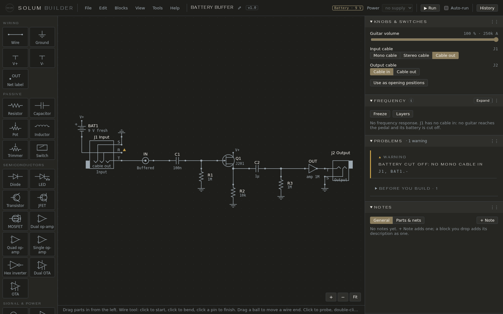

# Power

A pedal's power starts at the adapter's DC plug: mains is never simulated. There are four power parts, and most circuits need none of them.

## The Power menu

**Power**, in the header, is the supply plugged into the pedal: 9 V, 12 V, 18 V, ±9 V, ±12 V or ±15 V, or **Custom…** for any other. It always sets **V+** (and **V−** on a ± supply): every V+ bar on the sheet is that supply. It's ideal and perfectly clean.

**Custom…** sets the type, **+** (for most pedals: NPN transistors, op-amps), **−** (for PNP circuits like the Fuzz Face, which run from −9 V) or **±** (a split supply), and the voltage of each side. Its **Compare supply voltages** box runs the circuit at up to five voltages, overlaid on the plots: does it still work on a flat battery, how much more headroom at 18 V?

Beside the menu, after a run, is the current the circuit draws from the supply (*1.82 mA*): what to size a battery or an adapter by.

18 V or −9 V made *inside* the pedal from a 9 V supply is a charge pump's job, on its own net: see [Charge pumps and regulators](#charge-pumps-and-regulators).

## Which parts to draw

| You want to… | Draw |
|---|---|
| just power the circuit | nothing: the Power menu does it |
| draw the power section, for a full drawing and the parts list | a **DC jack** |
| run it from a battery, or switch between plugged in and battery | a **DC jack** and a **battery** (the *9 V power · DC jack and battery* block) |
| switch the battery off when the guitar cable comes out, as pedals do | a **battery** with its − on a stereo input **Jack**'s ring (the *… switched by the input jack* blocks): see [Jacks and cables](#jacks-and-cables) |
| hold another net at a voltage of its own | a **DC source** |

### DC jack

The DC jack draws the real jack: its sleeve **+** wired to V+, its centre **−** to ground (centre negative, as pedal supplies are), and its battery lug. It makes no voltage of its own: to the simulation it's a V+ label and a ground. It's there for a full drawing, the parts list and export. There's one per circuit, always called DC.

With a battery wired to its lug, Knobs & switches gets a **Power** switch, the DC plug in or out: **DC jack** (a plug in: the Power menu's supply powers the pedal and the battery is cut off) or **Battery** (no plug: the battery lug touches the sleeve and the battery powers it). A chip left of the Power menu says which: *DC jack*, or *Battery · 7.4 V* with the menu greyed.

With a DC plug in, the input jack's cable doesn't matter to the power: the supply powers the pedal whether or not the battery is switched on. Pull the DC plug (**Battery**) and the battery is on only while a mono cable is in the input jack, if its − goes to the jack's ring.

### Battery

A 9 V battery, its voltage picked by how used it is (from Energizer's 522 datasheet, on a pedal's load): **Fresh (9 V)**, **Half used (7.4 V)**, **Low (6.6 V)**, **Nearly flat (5.5 V)**, or your own measured voltage. An internal resistance is optional; measure it as the drop in volts on a known load, divided by the current.

Where its **+** goes decides what it powers:

- **On V+, no DC jack drawn**: it powers the pedal, and the Power menu is greyed.
- **On the DC jack's battery lug** (the jack's + on V+): it powers the pedal while no plug is in; plug one in (Knobs → Power) and the Power menu's supply takes over, the battery cut off. This is how pedals are wired.
- **On V+ beside a DC jack**: unplugged, it powers the pedal; plugged in, it stays connected beside the supply. It then needs an internal resistance for the circuit to run, and Problems warns that the jack doesn't switch it.
- **On any other net**: it powers only what's on that net, and the Power menu keeps V+.

Its **−** goes to ground, so it's always on, or to a stereo input jack's ring, so that plugging a guitar cable in switches it on: a mono plug's long sleeve joins the ring to ground. That's how pedals save their batteries, and it's the next section.

## Jacks and cables

A **Jack** (in Signal & power on the palette) draws a real input or output jack: **mono** (tip and sleeve) or **stereo** (tip, ring and sleeve), picked in its form. It's left out of the simulation as a part, but what's plugged into it is not: a jack can take the guitar out, the amp out or the battery off, as pulling a cable does on a real pedal.

### What a jack switches

What a jack's cable does depends on what it's wired to:

- **The input jack**: its T plugs into the middle of IN (the guitar), a wire from T to IN's plug point (see [Drawing](drawing.md#jacks)). With no cable in, no guitar reaches the pedal.
- **The output jack**: its T plugs into the tip of OUT (the amp). With no cable in, nothing reaches the amp.
- **A stereo jack with its ring and sleeve both wired**: its ring is a switch, joined to the sleeve only by a mono plug. Wire anything there; most often it's the battery's −.
- **A jack wired to none of these**: a drawing for the build. Its cable changes nothing.

Each jack that switches something gets a switch in Knobs & switches, named by the jack's label (*Input cable*, *Output cable*) or its ref (*J1 cable*):

- a mono jack: **Cable in** or **Cable out**;
- a stereo jack: **Mono cable**, **Stereo cable** or **Cable out**. A stereo (TRS) cable's ring is its own, so it doesn't join the jack's ring to the sleeve: a stereo cable in the input leaves the battery off, as on a real pedal.

Like any knob, it isn't an edit: the circuit opens with the cables in, unless you set otherwise with **Use as opening positions**.

### What happens with a cable out

| What's pulled | Power | Frequency and Scope | Audio |
|---|---|---|---|
| the input jack's cable (or a stereo cable in it), its ring the battery's − | the battery is cut off: DC voltages read about 0 V | none: each says which jack and what it cuts | refused, saying why |
| the input jack's cable, the battery's − on ground | unchanged | none, as above | refused |
| the output jack's cable | unchanged | none, as above | refused |
| a stereo cable in the input jack, the battery on its ring | the battery is cut off | the guitar still comes in: the circuit is simulated unpowered | renders: you hear the unpowered pedal (a true bypass still passes the guitar) |
| a cable from a jack whose ring switches the battery but isn't the input | the battery is cut off | simulated unpowered | renders, unpowered |
| a cable from a jack wired to nothing that matters | unchanged | unchanged | unchanged |
| any cable, with a DC plug in (Power: **DC jack**) | the supply powers the pedal | as above for the input and output jacks | as above |

A refused render says what to do: *J1 has no cable in: no guitar reaches the pedal and its battery is cut off. Put its cable in (Knobs) to render.*

While the battery is cut off and nothing else powers the circuit, Problems warns **Battery cut off: no mono cable in** (or *a stereo cable in*) and checks only the drawing: no bias warnings about a circuit that's simply off.

The *9 V power* blocks come both ways: *battery only* and *DC jack and battery* keep the battery on all the time (simplest, for hearing a circuit), and *… switched by the input jack* put its − on J1's ring. Insert one, then wire J1's T (its **in** label) to IN's middle, so that J1 is the input jack: pulling its cable then takes out the guitar and the battery together.

### DC source

An ideal voltage of its own, on a net other than V+ and V−: a steady 4.5 V reference to rule out a divider, a second separate supply, a test voltage on a node. Label the parts it powers with its net's name. It can't go on V+ or V−, which the Power menu supplies: Problems says so and the circuit doesn't run until it's moved.

## Charge pumps and regulators

A voltage the pedal makes itself, like 18 V from a 9 V supply for more headroom, or −9 V for an op-amp's negative side, comes from a **charge pump** part (ICL7660, LT1054, MAX1044, TC1044S) wired as its datasheet shows: a flying cap from pin 2 to pin 4 makes −V+ on pin 5; a cap from pin 2 to two diodes makes 2 × V+. The **Charge pump** blocks have them drawn, with chips or with an op-amp. A **regulator** (78L12) holds 12 V from a pump's 18 V; the *12 V supply* blocks have that drawn too.

A charge pump switches at its own frequency. Problems warns when that is inside the audio band (a TC1044S pumps at about 22 kHz only with pin 1, *boost*, wired to V+). To hear its whine, turn on *Charge pump switching* in the Audio pane's Pedal drawer; renders are then about ten times slower.

## Problems about power

Problems checks that a chip has power and the right way round, that nothing shorts a supply, that no supply is over a chip's maximum, that a supply isn't mostly lost in its filter (a diode in backwards), that a supply has a bulk capacitor where it comes in, and that a regulator's input is high enough to regulate.
