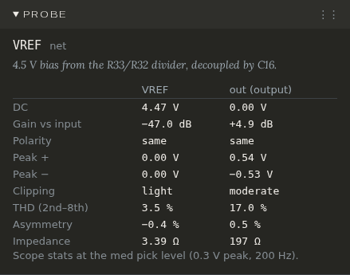
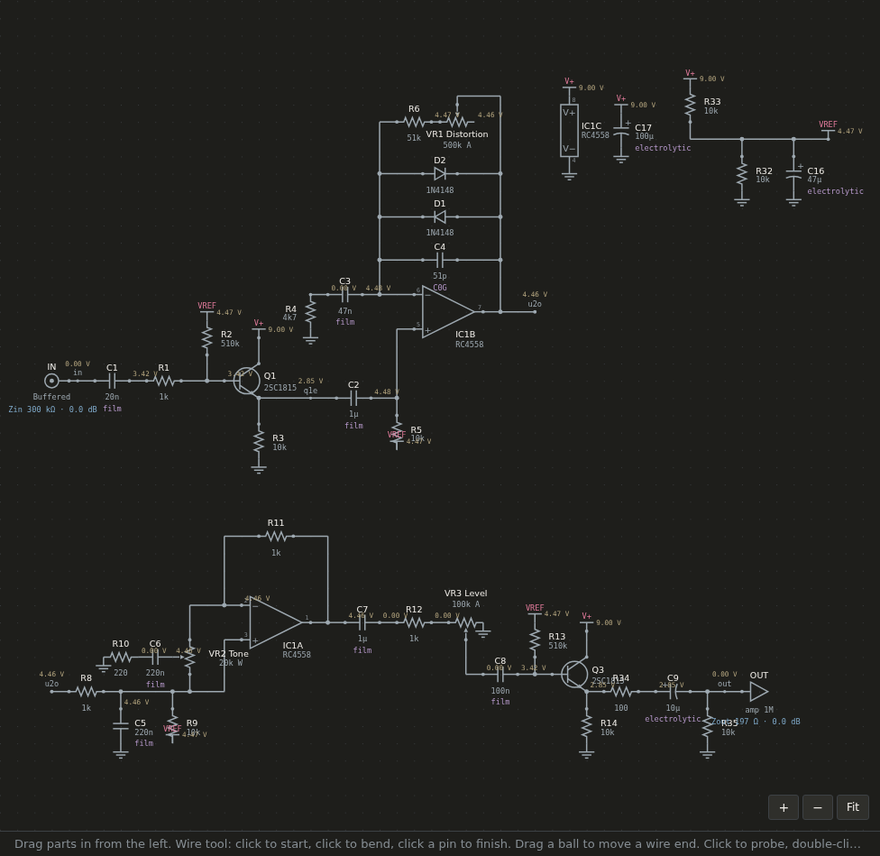

# Probing

Click any wire or part to probe it. The Probe, Scope, Harmonics and Frequency panes then show that point. Every number comes from a real simulation of the whole circuit (ngspice), run when you press **▶ Run** or, with **Auto-run** on, after every change.

When the circuit has changed since the last run, a line at the top of the panes says so: *The circuit changed since these results*.

## The test signal

The Probe, Scope and Harmonics panes play a steady **200 Hz** sine at the guitar input, at one of three levels, the **pick levels**:

| Pick | Peak at the guitar | Like |
|---|---|---|
| Soft | 0.1 V | a single coil played lightly |
| Medium | 0.3 V | a humbucker played normally |
| Hard | 1 V | picking hard |

Choose the level with the Soft / Medium / Hard buttons in the Scope pane.

## Probing a net

Click a wire (or a row in the DC pane, or a pin in a part's Probe view). Probe shows the net's name and, beside it, the circuit's output for comparison:

- **DC**: its voltage to ground with no signal.
- **Gain vs input**: how much louder than the guitar it is, in dB.
- **Polarity**: *same* or *inverted* against the guitar.
- **Peak +** and **Peak −**: how far the signal swings each way.
- **Clipping**: clean, light, moderate or heavy, and **THD (2nd–8th)**: how much of the signal is harmonics, in %.
- **Asymmetry**: how lopsided the two peaks are.
- **Impedance**: what the net looks like from outside at 1 kHz: low on a supply or an op-amp's output, high on a pot's wiper.

A net with a note (see [Notes](notes.md)) shows it under its name. A net with no name of its own is called after a pin on it: `Q1.B` is the net on Q1's base.

## Probing a part

Click a part's body. Probe shows what matters for that kind of part:

- **Resistor**: the voltage across it, the current, the power, and its rating.
- **Capacitor**: the DC across it and its rating; what it does with the parts around it (a note like *With R4, a high-pass in the feedback leg (about 720 Hz)*). The Frequency pane shows the curve on each side of it.
- **Pot**: its rotation and taper, and the resistance each side of the wiper.
- **Diode**: the DC across it and through it, how far the signal swings across it, and its I-V curve with that swing drawn on it.
- **Transistor**: NPN or PNP, Vbe, Vce, Ic, Ib and β; where it's judged from (the collector, or the emitter for a follower); and its **room up** and **room down**: how far its output can swing each way before it runs out, against how far it swings now. A curve of collector current against Vbe marks its working point.
- **JFET and MOSFET**: Vgs, Vds and Id, judged at the drain (or the source for a follower), its room up and down, and a curve of drain current against Vgs.
- **Op-amp**: its output's DC, its supply, its inputs (and whether they stay inside the datasheet's input range), and its room up and down.

Every part's view ends with its pins: which net each is on and its DC. Click a pin's row to probe that net.

## Scope

The waveform at the probed net, over a few cycles of the 200 Hz tone. The guitar's signal is drawn faintly behind it, scaled to the same height, so you can see the shape change: flattened tops are clipping, a lopsided wave is a stage biased off centre.

**Freeze** keeps a copy of the trace to compare against the next change; **Clear snapshot** removes it.

## Harmonics

The overtones the circuit adds to the 200 Hz tone, at the Scope's pick level, measured at the probed net. Each bar is how far that harmonic sits below the tone itself: 2 is 400 Hz, 3 is 600 Hz, and so on. Even and odd harmonics are coloured apart: even ones (2nd, 4th) come from lopsided clipping and sound warmer; odd ones (3rd, 5th) come from symmetrical clipping and sound harder. A clean circuit has none worth seeing.

## DC

The DC pane lists every net's voltage at the last run, the supplies and the guitar's and amp's nets first. Click a row to probe that net. It starts folded.

## On the sheet: the View menu

- **DC voltages on schematic** writes each net's DC voltage on the drawing.
- **Impedance in and out** shows, at 1 kHz, what the pedal's input looks like to the guitar (Zin) and its output to the amp (Zout), and what that loading does: the level lost (or gained) at the input against the guitar unloaded, the pickup's resonant peak straight into the amp and into the pedal, and the level the amp gets.
- **Capacitor types** writes each capacitor's kind under its value.
- **Problem marks** marks each problem on the drawing, coloured by how serious it is; hover one for its message, click it to open it in Problems. See [Problems](problems.md).

## When a result can't be trusted

A frequency curve is drawn for small signals around the circuit's resting point. If a stage is stuck (an op-amp at a supply, a transistor fully on or off), the curve is meaningless. The Frequency pane then greys it and says so above it: *This curve doesn't show what the circuit does*, which stage is stuck, and to fix the bias first. Problems names the stage.
