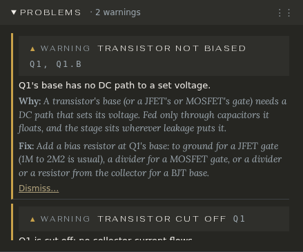

# Problems

The Problems pane checks the circuit against a book of rules, in plain English, every time it runs. Each problem says what's wrong, why it matters and what to do.

## Reading a problem

The pane's title counts them (*Problems · 2 warnings*). Each row has:

- **How serious it is**: an **error** (it won't work, or something will be damaged), a **warning** (it works, but probably not as meant), or a **note** (worth knowing, often for the build).
- **Its title** (*Transistor cut off*) and **where**: the parts and nets it's about.
- Opened: the message (*Q1 is cut off: no collector current flows.*), **Why**, and **Fix**.

Click a row to select the parts it names and probe them. With View → **Problem marks** on, each problem is also marked on the drawing, coloured by how serious it is; hover a mark for its message, click it to open its row.

Notes about the build (a capacitor with no kind, no enclosure chosen) gather under **Before you build**, so they don't hide the problems that matter while you design.

## What is checked

- **The drawing**, before any simulation: a net with no DC path to ground, a chip with no power, an op-amp with no feedback or an input with no bias, an LED with no resistor, a supply shorted, two names on one net, a part shorted out or not wired in, the signal path broken, a model not in the library, an electrolytic with no voltage rating, an unused half of a dual op-amp, a switch input with no pull-down (the pop when you stomp), a battery that the DC jack doesn't switch.
- **The working point**, after the DC simulation: a transistor cut off or saturated, a JFET pinched off or in its ohmic region, an op-amp stuck at a supply or with its inputs out of range, DC at the output, a part over its voltage, current or power rating (or close to it), an electrolytic reversed, a supply sagging on its way in, a regulator that can't regulate.
- **The simulation itself**: when ngspice can't find a solution, or a bias target can't be reached.

Some problems stop the run: ngspice would make up a voltage on a net with no DC path, so nothing is simulated and the banner says *Can't simulate yet:* and why. A part joined by only one pin is left out instead, and the rest runs; click it and Probe says it isn't wired in, with no readings. When a run is refused or fails, Probe names what you have selected and says why there is nothing to show.

## Dismissing a problem

Sometimes a rule is wrong for your circuit: a starved fuzz runs its transistor nearly cut off on purpose. Open the row and press **Dismiss…**, give a reason if you like (*a starved fuzz, on purpose*), and press **Dismiss**. The problem moves to **Dismissed** at the bottom of the pane, loses its mark on the drawing, and the reason is saved with the circuit. **Bring back** returns it. Dismissing is an edit: Undo takes it back.

## Problems that are easy to misread

- *Op-amp half not used* and *Chip unit not used*: a dual op-amp with one half spare. Left floating, the spare half can swing between the supplies or oscillate; the fix says how to wire it.
- *Pin not in the model*: a pin you wired (an op-amp's offset pins, say) that the model doesn't have. The simulation leaves it open; on the real chip it matters.
- *Custom switch*: a switch with your own contacts may not match any switch sold, so the parts list can't name one to buy.
