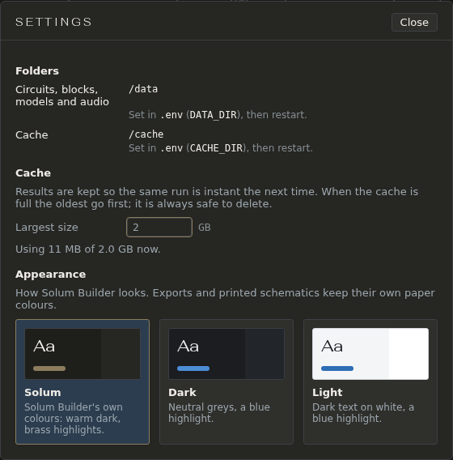

# Settings

File → **Settings…** has the few things that are about the app and not about one circuit: where it keeps your files, how large its cache may grow, and how it looks. A change holds at once; there is nothing to save. Esc or **Close** shuts it.

## Folders

Where the app keeps things, shown so you can find and back them up:

- **Circuits, blocks, models and audio**: everything you make or add. Back this folder up.
- **Cache**: saved results and the search index. It is always safe to delete; the app rebuilds it.

With Docker, or running from source, the folders are chosen outside the app, so each says **Set in `.env` (`DATA_DIR`), then restart** (`CACHE_DIR` for the cache). With Docker the paths shown are the ones inside the container, `/data` and `/cache`; the folders on your machine are the ones `.env` names, `data/` and `cache/` beside `compose.yaml` unless you changed them.

## Cache

Results are kept so the same run is instant the next time. **Largest size** is how much disk they may take, in GB; when the cache is full the oldest results go first. Type a new size and press Enter: it holds straight away, with no restart, and if the cache is already larger the oldest results are dropped then. The line below says how much is in use now.

A size set here is kept with your files and wins over `CACHE_MAX_GB` in `.env` from then on.

## Appearance

Three themes: **Solum** (the app's own colours: warm dark, brass highlights), **Dark** (neutral greys, a blue highlight) and **Light** (dark text on white, a blue highlight). Click one and the whole app changes, this guide included. Exports and printed schematics keep their own paper colours.

## What the app remembers

The theme, **Auto-run**, the order of the panes, which panes are open and which are out as large views are kept with your files, not in the browser. So they are the same in any browser you open the app from, and they survive clearing the browser's data. View → **Reset pane order** puts the panes back.

Smaller things stay with the browser you set them in: how far the pane list is scrolled, list or grid in the Open and Blocks windows, the Frequency pane's layers, the Audio pane's picks, and View's **Capacitor types** and **Problem marks**.
