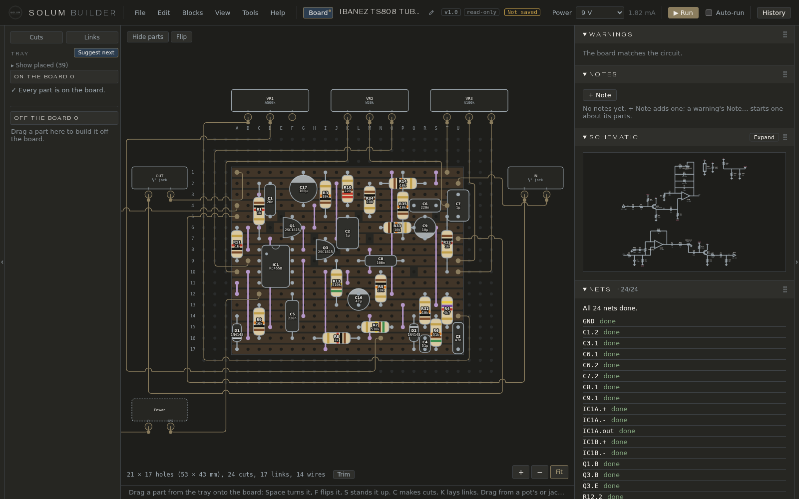
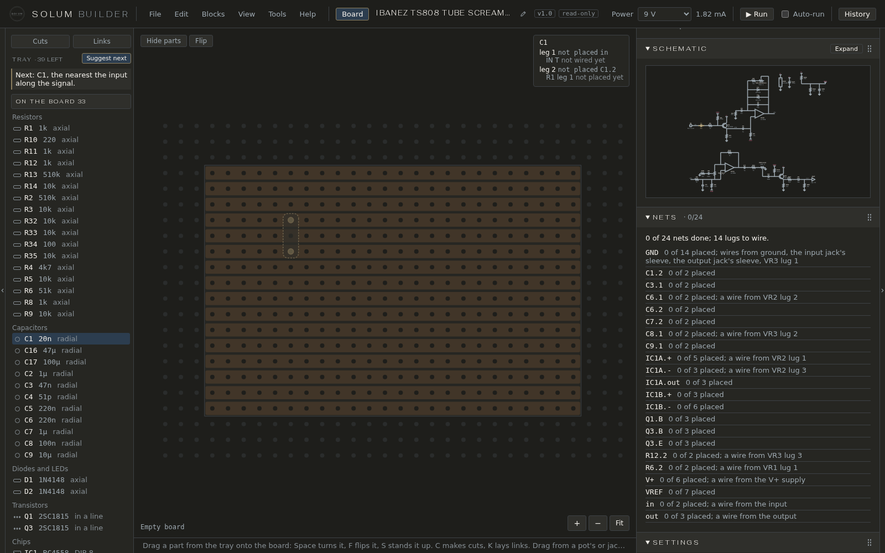
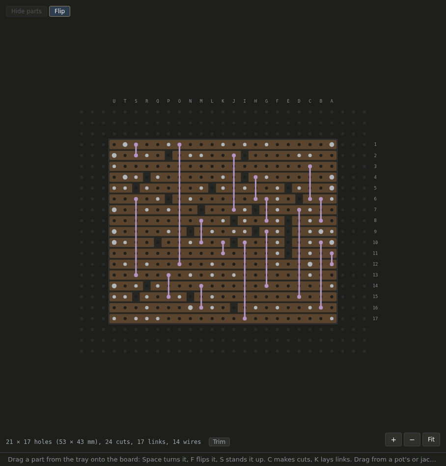

# Stripboard

Plan the stripboard (Veroboard) for a circuit before you solder it. The board is laid out from the circuit you drew: every part it needs is waiting in a tray, each leg shows where it must connect, mistakes are named as you make them, and the finished board is checked against the circuit before it goes in the build package. You lay it out by hand, as builders do: the app only stops what can't be built and warns of what looks wrong. Or you can have the app lay the whole board out for you, as a draft to look over.

## Opening the board

Click **Board** in the header, just before the circuit's name (or Tools → **Stripboard layout**). Click it again to go back to the schematic. The button has a small mark once the circuit has a board.

The first time, the board is empty and every part is in the tray. Nothing is saved until you place something, so a look costs nothing. A board is kept in the circuit file and saved with it; **Clear board**, at the bottom of the board's Settings pane, takes it away after asking (Undo brings it back).

The Board view swaps the screen around:

- **Tray** on the left, in the palette's place: the parts still to place.
- **The board** in the middle, at real proportions, seen from the parts side. The line under it gives its size, cuts, links and wires: *20 × 16 holes (51 × 41 mm), 20 cuts, 11 links, 14 wires*.
- **The board's panes** on the right, in the result panes' place: **Warnings**, **Notes**, **Schematic** (a small copy; selecting a part lights it on both drawings; **Expand** shows it large over the board), **Nets** and **Settings**. They move and fold as the result panes do, and keep their own order. Back in the schematic the result panes return as they were.

The tray and the board's panes hide here as the palette and the result panes do in the schematic (the bars at the window's edges, **[** and **]**): a click on a bar brings its side back, and resting on it peeks the side out, over the board and over a pane that is out as a large view. Clicking a warning's mark while its side is hidden peeks that side out too, with the row in view. The Board view keeps its own: hide the tray here and the palette stays in the schematic.

Undo, Redo and History follow the view: the board has its own steps, so undoing on the board never undoes a schematic change. Save keeps both.

## The tray

The tray lists the circuit's parts, grouped by kind, each with its value and the shape it goes on the board in (*R1 1k axial*, *Q1 2SC1815 in a line*, *IC1 RC4558 DIP-8*). The board can only hold the circuit's parts: nothing is added or removed here, and a part's size follows what the schematic says about it (a resistor's rating, a capacitor's kind and value, a transistor's package).

- **On the board**: the parts that are soldered to it.
- **Off the board**: pots, switches, jacks, the DC jack, the battery and the status LED, which sit beside the board and are joined to it by wires. **Power** stands for the supply's wires when the schematic draws no battery or DC jack.
- **↓ Off board** and **↑ On board**, on a row as you hover it, move a part to the other list (or drag the row across). A part with no board shape, such as a pot, can't go on the board, and says why.
- **Show placed** lists the parts already on the board.
- **Can't be placed yet** names parts the board doesn't know how to hold yet: a capacitor with no kind, a model with no package, a surface-mount transistor not on an adapter. Set it in the part's form in the schematic.

The footswitch and status LED come from the schematic: add the **True bypass** block there and wire it in, and they appear in the tray like any other part.

## Placing parts by hand

Drag a part from the tray onto the board, or click it and then click where it goes. While a part is carried:

- the holes where its legs would join their nets are marked;
- a card at the top right lists its legs, each leg's net and the pins it must reach;
- **Space** turns it, **F** flips it end for end, **S** stands it up (a resistor or diode) or lays it flat, **+** and **−** make its legs longer or shorter;
- **Esc** drops it back in the tray.

Drag a placed part to move it; **Del** sends it back to the tray. Right-click a part for the same moves, **Back to the tray**, and for a trimmer its other shape (below). Hovering a part names its legs.

Grab a part or a wire and drag it to move it. **Ctrl+F** (Edit → **Find part…**) works here as on the schematic: it brings the part into view and rings it on the board, or flashes its row if it's still in the tray, then selects it on both drawings. Two buttons at the top of the tray change what a click does until you turn them off: **Cuts** (C) cuts the strip at a hole or mends a cut, and **Links** (K) lays a wire link down a column, or lifts one. Click the button again, or press Esc, to go back to moving parts.

With **Links** on, **drag from the end of a link** to another strip to lay a **tap**: a second link starting in the same hole, so one strip is joined to two others down one column (published boards do this to join three strips with two links). The shared hole is drawn with a dot. A click on a link lifts it. Right-click a link where it passes over a hole and choose **Tap here** to split it in two there, both ending in that hole: a bare link soldered to a strip it crosses.

### Guidance as you go

- **What to place next** sits at the top of the tray: *Next: C1, the nearest the input along the signal.* It follows the signal and prefers a part whose nets are already on the board. A part that must sit by a pin already placed comes straight after that part: *Next: C4, by IC1's pin 6: a feedback part.*
- **Ratsnest lines**, dashed, join the pieces of each net still to connect.
- **Suggested cuts and links** are drawn faded: click one to make it. A button under the board makes all of them at once. Nothing is cut or linked behind your back.
- **Mistakes are named as they're made**: a short between two nets (drawn red), a part the wrong way round (each leg is a named pin, so a reversed electrolytic or transistor is caught), a leg on the wrong strip. Values aren't checked here: the parts list carries them.

There's no rule about where a part goes, or how close it sits to a pin, or which strip runs beside which: that's the builder's judgement, and the published layouts break every such rule when it suits them. See *What the board checks*, next.

### What the board checks

The board tells **faults** from **warnings**. A fault means the board can't be built or isn't the circuit: it stops the board passing, and a move that makes one is refused (unless **Allow shorts** is on, below). A warning says something looks wrong but the board still matches the circuit, and you can dismiss it.

**Faults:**

- a short between two nets, a net left in pieces, a part the wrong way round, a leg on the wrong strip, a wire's end with no hole, a part missing from the board or one that isn't in the circuit;
- **legs too close**: each part has a least span from its real size, and no most, since long leads are yours to choose. A ¼ W resistor lies flat from 4 holes (legs 3 apart) or stands from 2; a small diode (DO-35, DO-34, DO-41) lies flat from 3 holes; a film capacitor from 3 holes, a ceramic from 2. The message says what to do: *R3's legs must be at least 4 holes apart.* A standing part's legs stretch the same way;
- two legs of one part in the same hole, a leg or link end in a cut, a body over another part's leg, two bodies on one hole, a part off the board, a link not running down a column.

**Warnings:**

- **Two things from different parts in one hole**: *C2 and R3 share F7: check both leads fit.*
- **A leg between a chip's rows**: *R5 sits under IC1: only if the chip is in a socket and the part is low enough.*
- **A link passing over a leg, a wire's hole or another link's end**: *The link from B1 to B8 passes over R2 at B4: use insulated wire for it.*
- **Bodies that touch**, and a body hanging off the board's edge (below).

**Allowed, with nothing said:** a link under any body (an electrolytic, a film capacitor, a transistor) and ending there, soldered from below; a link over cut holes; two link ends in one hole (a tap); a cut in either middle column of a chip, strip by strip; a part lying along a strip with a cut under its body.

A link laid on top of a strip it duplicates is refused (*There's a link from B1 to B8 already.*).

**An axial electrolytic.** An electrolytic's form in the schematic has **Leads**: *radial* (both at one end: stands up, the usual) or *axial* (one at each end, like a resistor). An axial one is sized from a maker's sheet by its value and lies across the board or stands like a resistor, its minus end banded. The parts list calls it an *axial electrolytic*, since it's bought as a different part.

**Keep the input away from the output.** The board no longer warns about it, but a guitar's input wire and the output's, run side by side, can make a high-gain pedal squeal. Put the jacks apart, and keep their wires apart as the pedal's wiring will: that's yours to judge.

When you pick up a part, the holes where its legs would join their nets are marked, and the card lists its legs: that's all the guidance there is about where it goes.

### Bodies that touch

Parts are drawn at their real size, so two bodies that touch between holes (usually larger capacitors), or one hanging off the board's edge, is a warning: *C2 and R5's bodies touch: move one a hole further away if you can.* It isn't a fault, and the board still passes. Often it's fine on the real board: a capacitor stood a little higher, or bent aside. Each such warning has:

- **Note…** writes a note about those parts, kept with the board (see *Board notes* below).
- **Dismiss…** hides it, with a reason if you like. It's listed under **Dismissed** with **Bring back**. A dismissal lapses when the parts no longer touch.

View → **Problem marks** marks each of these on the board where the bodies meet; click a mark to see its warning.

## Off board parts and wires

Drag a pot, jack or switch out of the tray to beside the board. Each is drawn by type with its lugs: a pot's three, a jack's T and S (T, R and S for a stereo jack), a footswitch as its square of lugs. Drag from a lug to a hole on the board to wire it, or to another lug; a wire can be left loose for now (it counts as still to do). Click a wire to light its net, on the board and the schematic. Drag a wire's end to move it, or its middle to move its path. Right-click a wire to **Route it for me** again, **Leave its end loose** or **Take the wire off**, and an off-board part for **Back to the tray, with its wires**.

**Wire it for me**, under the board, puts every off-board part at its usual spot (the pots along the top in knob order, the input jack on the right, the output on the left, the footswitch below) and wires each lug to the free hole on its strip that the shortest wire reaches. Wires run round the board's edge, keep off parts and switches' names, and hop where they cross; a wire whose hole sits between two parts drops in between them.

A wire on the wrong net is named at once, like a leg.

## Board size

The board is whatever is on it: the box around every leg, body, link and wire pad. A margin of free holes around it takes new parts, and placing into it grows the board (**Auto-grow**, in Settings; off, a part past the edge is refused). Click a ruler's letter or number to insert a column or strip there, or remove an empty one; a part across it stretches or squeezes when its legs allow. **Trim**, under the board, takes off empty lines at the edges.

## Seeing the copper

- **Flip** shows the back of the board: the copper side, turned over as you hold it to solder, with the strips, the holes used, the cuts and the links. Click it again for the front.
- **Hide parts** shows the copper seen through from the front, lined up with the parts side, so you can match a strip to a part. It's greyed while the board is flipped.
- **See-through** (T), in Settings, fades the parts so the holes and cuts under them show.

Links are drawn in lavender on both sides. **Rails**, in Settings, tints the supply's copper and ground's.

## Letting the app lay it out

**Lay it out for me…**, at the top of the board's Settings pane, has the app lay the whole board out: the parts placed, the cuts and links made, the off-board wires run, and the board checked against the circuit. It replaces what's on the board, so it first says what it will replace (*This replaces everything on the board: 34 parts, 14 cuts and 15 links. One step to undo.*) and that you can stop it early. Click **Lay it out** to go on, or **Cancel**. Your board notes, your dismissals and the parts you moved off the board are kept.

**The layout is a draft.** Look it over before you build it. A board laid out by hand is usually smaller, and the bigger the circuit, the more so: past 25 board parts the running window says *This circuit has 42 parts: a layout made for you will likely be larger than one laid out by hand. Use it as a draft and look it over.* A small circuit (14 board parts or fewer) can come out smaller than the published board.

**Standing resistors and diodes**, in the same window, says whether the app may stand a resistor or diode up (its body over one hole, its lead bent down to the next). It opens on the board's own choice, kept with the board:

- **Never**: everything lies flat.
- **When needed** (the first choice on a new board): a part stands only where lying flat leaves a warning that standing clears, and a standing part is taken over a bigger board only to clear one. With the rules as they are there are few such places, so most boards come out flat.
- **Prefer**: stood up wherever it fits.

### How it works

It starts from a base layout: the parts in signal order from the input, each net carried along a strip, a part's legs going across the strips to reach their nets, and any net left in pieces given a strip of its own across the board with each piece linked to it. That board always passes the check but is roomy. It then **searches**: thousands of random changes (slide a part, change its shape, swap two parts, take out an empty line, move a part a long way), with the cuts and links worked out again after each, and a change that makes the board better is kept. Early on a change that makes it a little worse is sometimes kept too, so the search can get out of a dead end, and that happens less and less as it goes on (the method is called simulated annealing). Parts never land on each other, and no new touching bodies are made.

It makes four such attempts side by side, each from a different random start, and keeps the best board; when parts may stand, a fifth lays everything flat, so allowing standing never leaves a board worse than lying flat would. The best is the one with the fewest standing parts (When needed), then the smallest (columns × strips), then the fewest cuts and links, then the shortest links. Each attempt runs a fixed number of steps (more for a bigger circuit), not a fixed time, so the same circuit and choice give the same board on any computer. A board only counts if it can be wired: no shorts, every net joined, every leg on copper; if none is found you get the base layout, with *Couldn't do better than the base layout: here it is.*

### While it runs

A window shows its progress, the time it has left on this computer, and the best board so far (*Best so far: 17 × 9 holes, 11 cuts, 8 links*), and the board behind redraws as it improves. It can't be edited until the end. **Stop and keep the best** ends early with the smallest board found, wired and checked first; **Cancel** puts the board back. If a run goes past its estimate it says *Taking a little longer than expected…* and carries on. The time is a few seconds for a small circuit, under a minute for a TS808, a few minutes for a Klon or BD-2.

### Looking before you keep it

When it's done, **Review the layout** opens at the top of the right-hand column and compares the two: *Before 34 × 13 holes, 14 cuts, 15 links → After 15 × 7 holes, 11 cuts, 6 links*. Until you keep a board, the canvas has a yellow outline and the board can't be edited: the tray, the panes, Cuts and Links are faded. **Flip** and **Hide parts** still work, on both boards in Both, and so does T for See-through. If you'd hidden the right-hand column, it comes back as the review opens; you can hide it again (**]**) to look at the board, and its bar, *Show the review*, brings it back.

- **After**, **Before** and **Both** show the new board, the old one, or the two, one above the other.
- **Try another** searches again from the same start with other random moves, for a different board (sometimes a little smaller, sometimes bigger). **◀** and **▶** step between the tries. A circuit with little room says the try gave the same board as an earlier one.
- **Keep try 2** keeps the try showing (one step to undo). **Keep the old board** puts back what was there; on an empty board it reads **Keep the base board**, the base layout.

The layout is the app's: check it, and adjust it if you need to, before you build it on a real board.

## Board settings

The Settings pane's buttons turn each setting on (shaded, with an edge in the highlight colour) or off. They're remembered for you on this computer, for every circuit.

Under **Show**:
- **Values**: label each part with its value as well as its ref.
- **Rails**: tint the supply's and ground's copper.
- **Ratsnest**: the dashed lines joining the pieces of each net on the board that aren't joined yet. Off, only the lines of the part selected or carried.
- **See-through** (T): the parts faint, so the holes and cuts under them show.

Under **While editing**:
- **Auto-grow**: the board grows to take in what's placed past its edge.
- **Allow shorts**: a move that makes a short is allowed, and the short is shown red. Off, it's refused.

**Clear board**, at the bottom, asks first. **Lay it out for me…** is at the top. **Suggest next**, in the tray's heading, turns the suggestion at the top of the tray on or off. **Hide parts** and **Flip** are on the board's own bar, shaded while they're on.

A trimmer goes on as the square single-turn kind (triangle, Bourns 3362P) unless its form's **Board trimmer** says in line (Bourns 3296W); a placed one's right-click menu changes it too. A surface-mount transistor goes on the board on a TO-92 adapter, set by its form's **Mounting**.

## Nets and warnings

**Nets** lists every net, *done*, *in pieces* or *shorted*, with how many of its legs are placed and which wires it still needs: *18 of 24 nets done; 14 lugs to wire.* A long list scrolls inside the pane, so the panes below stay in reach. Click a net to light it on the board and the schematic.

**Warnings** lists faults first, then the warnings. When the board is complete and right it says *The board matches the circuit.*

## Board notes

The **Notes** pane holds notes about the board itself: *C2, R1: solder C2 a bit higher.* **+ Note** adds one, about some parts or the whole board; a touching-bodies warning's **Note…** starts one with its parts filled in. A note goes out of date, dimmed and saying why, when a part it names is no longer on the board or, for one written from a warning, when those parts no longer touch; it's never deleted for you. Board notes are printed on the build sheet. They're separate from the circuit's own notes ([Notes](notes.md)).

## When the circuit changes

The board is checked against the circuit every time it opens, so you can go on editing the schematic:

- a changed value still matches (the parts list carries values);
- a new part appears in the tray;
- a deleted part is named at the top of Warnings, with **Clear them** to take them all off the board;
- a rewired part shows its leg on the wrong net, and where it should go.

## In the build package

File → **Export…** offers **Stripboard (PDF)**, and the build package includes `stripboard.pdf` whenever the last save has a board that matches the circuit. It opens with a line saying so (*Every connection on this board matches the circuit (24 nets)*), then the cut list, the link list, the off-board wires numbered (*VR1 (Gain) lug 1 to F2*) and your board notes, the parts side with its wires, the copper side mirrored and not mirrored (each labelled), and a page with the board alone at real size, with a 25.4 mm line to check your printer's scale. The parts list names the board to cut: *Stripboard, 13 × 15 holes, cut to 33 × 38 mm, 0.1" pitch*.

A board that no longer matches the circuit is left out of the package, and its index says what doesn't match. See [Export and build](export.md).
