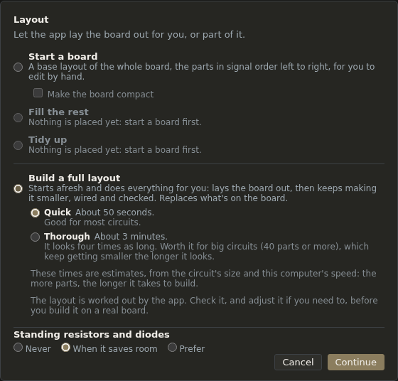
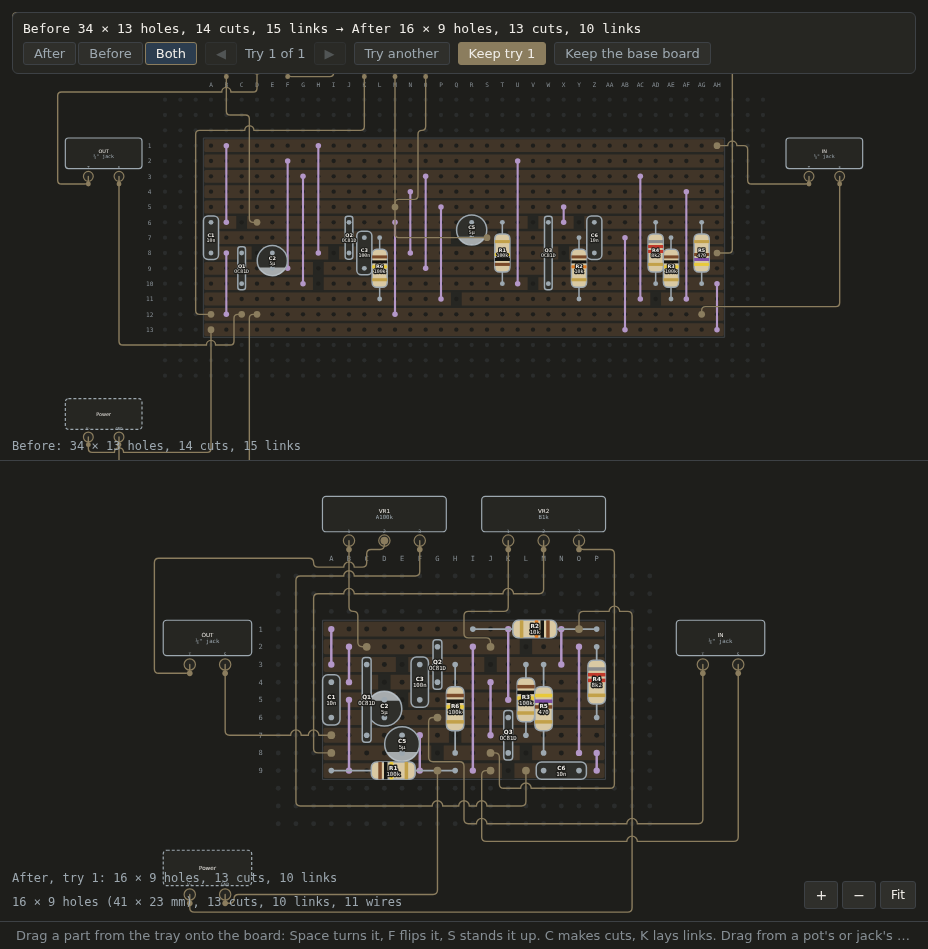

# Stripboard

Plan the stripboard (Veroboard) for a circuit before you solder it. The board is laid out from the circuit you drew: every part it needs is waiting in a tray, each leg shows where it must connect, mistakes are named as you make them, and the finished board is checked against the circuit before it goes in the build package. You can lay it out by hand, let the app start it for you, or have the app build the whole board.

## Opening the board

Click **Board** in the header, just before the circuit's name (or Tools → **Stripboard layout**). Click it again to go back to the schematic. The button has a small mark once the circuit has a board.

The first time, the board is empty and every part is in the tray. Nothing is saved until you place something, so a look costs nothing. A board is kept in the circuit file and saved with it; **Clear board**, at the bottom of the board's Settings pane, takes it away (Undo brings it back).

The Board view swaps the screen around:

- **Tray** on the left, in the palette's place: the parts still to place.
- **The board** in the middle, at real proportions, seen from the parts side. The line under it gives its size, cuts, links and wires: *20 × 16 holes (51 × 41 mm), 20 cuts, 11 links, 14 wires*.
- **The board's panes** on the right, in the result panes' place: **Warnings**, **Notes**, **Schematic** (a small copy; selecting a part lights it on both drawings; **Expand** shows it large over the board), **Nets** and **Settings**. They move and fold as the result panes do, and keep their own order. Back in the schematic the result panes return as they were.

Undo, Redo and History follow the view: the board has its own steps, so undoing on the board never undoes a schematic change. Save keeps both.

## The tray

The tray lists the circuit's parts, grouped by kind, each with its value and the shape it goes on the board in (*R1 1k axial*, *Q1 2SC1815 in a line*, *IC1 RC4558 DIP-8*). The board can only hold the circuit's parts: nothing is added or removed here, and a part's size follows what the schematic says about it (a resistor's rating, a capacitor's kind and value, a transistor's package).

- **On the board**: the parts that are soldered to it.
- **Off the board**: pots, switches, jacks, the DC jack, the battery and the status LED, which sit beside the board and are joined to it by wires. **Power** stands for the supply's wires when the schematic draws no battery or DC jack.
- **↓ Off board** and **↑ On board**, on a row as you hover it, move a part to the other list (or drag the row across). A part with no board shape, such as a pot, can't go on the board, and says why.
- **Show placed** lists the parts already on the board.
- **Can't be placed yet** names parts the board doesn't know how to hold yet: a capacitor with no kind, a model with no package, a surface-mount transistor not on an adapter. Set it in the part's form in the schematic.

The footswitch and status LED come from the schematic: add the **True bypass** block there and wire it in, and they appear in the tray like any other part.

## Placing parts by hand

Drag a part from the tray onto the board, or click it and then click where it goes. While a part is carried:

- the holes where its legs would join their nets are marked;
- a card at the top right lists its legs, each leg's net and the pins it must reach;
- **Space** turns it, **F** flips it end for end, **S** stands it up (a resistor or diode) or lays it flat, **+** and **−** make its legs longer or shorter;
- **Esc** drops it back in the tray.

Drag a placed part to move it; **Del** sends it back to the tray. Right-click a part for the same moves, **Back to the tray**, and for a trimmer its other shape (below). Hovering a part names its legs.

Grab a part or a wire and drag it to move it. Two buttons at the top left change what a click does until you turn them off: **Cuts** (C) cuts the strip at a hole or mends a cut, and **Links** (K) lays a wire link down a column, or lifts one. Click the button again, or press Esc, to go back to moving parts.

### Guidance as you go

- **What to place next** sits at the top of the tray: *Next: C1, the nearest the input along the signal.* It follows the signal and prefers a part whose nets are already on the board. A part that must sit by a pin already placed comes straight after that part: *Next: C4, by IC1's pin 6: a feedback part.*
- **Ratsnest lines**, dashed, join the pieces of each net still to connect.
- **Suggested cuts and links** are drawn faded: click one to make it. A button under the board makes all of them at once. Nothing is cut or linked behind your back.
- **Mistakes are named as they're made**: a short between two nets (drawn red), a part the wrong way round (each leg is a named pin, so a reversed electrolytic or transistor is caught), a leg on the wrong strip. Values aren't checked here: the parts list carries them.

### Placement limits

Some parts only work as drawn when they sit close to a particular pin. A long run of strip between them acts as an aerial and adds inductance: a decoupling capacitor far from its chip doesn't decouple, and a strip on a high-gain input picks up hum and noise that the stage then amplifies. The board reads these from the circuit:

- a chip's decoupling capacitor by its supply pin, and a charge pump's capacitors;
- an op-amp's feedback parts (those between its output and its − input) by the − input;
- a regulator's smallest capacitor on each side;
- a transistor's bypass capacitor by its emitter (a JFET's by its source);
- the parts in series with a high-gain stage's input. A stage's input counts as high gain when the gain from there to the output is 25 dB (about 18 times) or more at any one of three settings: the knobs as set, all turned down, or all turned up. "The output" is the input of the last knob on the way to the output jack (the Volume or Level, so turning it down doesn't hide the gain before it), or the jack itself when there's no knob. An input on a node of 470 kΩ or more counts from 20 dB (10 times): with the guitar's volume down nothing loads it, and it picks up hum easily. So an input buffer ahead of a drive counts, and a stage with little gain left after it doesn't. The app works this out by simulating the circuit. Parts whose other leg goes to ground, a supply or a reference voltage (a bias resistor, say) aren't kept: no signal reaches them there.

A limit is met when the part's leg is **on the pin's own strip, within 2 holes of the pin, joined to it directly along the strip**: no cut between them. A part that reaches the pin's net only through a link round a cut doesn't count. Each more part kept by the same pin gets one more hole: three feedback parts on one pin may be up to 4 holes away. These are warnings, not faults: the board still matches the circuit, and you can decide a part is fine where it is.

A chip's decoupling capacitor has a second, looser rule: its **ground leg within 4 holes of the chip's ground pin, counted along the copper** (along the strip, and through a link by its length: the way the current flows). A capacitor on a ground strip that's close by but joined to the chip's ground only far round fails: *C5's ground leg is 11 holes from IC1's pin 4 along the copper (its decoupling cap's loop): keep it within 4 holes along the strip or a link, so the loop stays small.* A chip on a split supply (a charge pump's ±9 V) has no ground pin, and isn't checked. The layout help doesn't follow this one: it's yours to check.

A limit broken is a warning that says what breaks it: *D1, D2 and C4 should sit by IC1's pin 6 at O15 (a feedback part): on its strip within 4 holes, nothing between. D1: it's 9 holes away.* When you pick up such a part, only the holes that keep it by its pin are marked; if none is free, the card says what's in the way.

The board also warns of a **link running under or beside a part on a high-gain input**, where it could pick up noise: *The link from I7 to I15 runs beside R5, on IC1's pin 5 (the high-gain stage's input): move it a column or two.* A link counts when it passes under such a part, within one hole of one of its legs in any direction, or under a chip with a high-gain input pin. Links on ground, the supplies and reference voltages don't count: they carry no signal to pick up.

And it warns of a **later node's strip running beside a high-gain input's**, which is how fuzzes and high-gain drives come to squeal: neighbouring strips couple a little, and at high gain that's enough for the output to feed back into the input. *Strips 8 and 9 run side by side from A to O: IC1's pin 5 (the high-gain stage's input) beside C4's pin 2, later and in phase with it. Cut one shorter or move it a strip further, so the output can't feed back into the input and squeal.* It counts only a node that would add to the input: louder than it and in phase with it (within a quarter turn) at 2, 10 or 50 kHz, with high gain between. An inverting stage's output beside its input only trims the treble, and isn't warned; nor is a stage's own feedback (its − input, its emitter, or a node a feedback resistor joins to the input). Two strips count when their copper runs side by side for 3 columns or more with no cut. The same goes for the **input and output jacks' wires**: when the output is in phase with the guitar, the board warns if their wires run side by side (in one lane or the next) for more than 10 mm.

### Bodies that touch

Parts are drawn at their real size, so two bodies that touch between holes (usually larger capacitors), or one hanging off the board's edge, is a warning: *C2 and R5's bodies touch: move one a hole further away if you can.* It isn't a fault, and the board still passes. Often it's fine on the real board: a capacitor stood a little higher, or bent aside. Each such warning has:

- **Note…** writes a note about those parts, kept with the board (see *Board notes* below).
- **Dismiss…** hides it, with a reason if you like. It's listed under **Dismissed** with **Bring back**. A dismissal lapses when the parts no longer touch.

View → **Problem marks** marks each of these on the board where the bodies meet; click a mark to see its warning.

## Off board parts and wires

Drag a pot, jack or switch out of the tray to beside the board. Each is drawn by type with its lugs: a pot's three, a jack's T and S (T, R and S for a stereo jack), a footswitch as its square of lugs. Drag from a lug to a hole on the board to wire it, or to another lug; a wire can be left loose for now (it counts as still to do). Click a wire to light its net, on the board and the schematic. Drag a wire's end to move it, or its middle to move its path. Right-click a wire to **Route it for me** again, **Leave its end loose** or **Take the wire off**, and an off-board part for **Back to the tray, with its wires**.

**Wire it for me**, under the board, puts every off-board part at its usual spot (the pots along the top in knob order, the input jack on the right, the output on the left, the footswitch below) and wires each lug to the free hole on its strip that the shortest wire reaches. Wires run round the board's edge, keep off parts and switches' names, and hop where they cross; a wire whose hole sits between two parts drops in between them.

A wire on the wrong net is named at once, like a leg.

## Board size

The board is whatever is on it: the box around every leg, body, link and wire pad. A margin of free holes around it takes new parts, and placing into it grows the board (**Auto-grow**, in Settings; off, a part past the edge is refused). Click a ruler's letter or number to insert a column or strip there, or remove an empty one; a part across it stretches or squeezes when its legs allow. **Trim**, under the board, takes off empty lines at the edges.

## Seeing the copper

- **Flip** shows the back of the board: the copper side, turned over as you hold it to solder, with the strips, the holes used, the cuts and the links. Click it again for the front.
- **Hide parts** shows the copper seen through from the front, lined up with the parts side, so you can match a strip to a part. It's greyed while the board is flipped.
- **See-through** (T) fades the parts so the holes and cuts under them show.

Links are drawn in lavender on both sides. **Highlight rails**, in Settings, tints the supply's copper and ground's.

## Letting the app lay it out

**Layout…**, at the top of the board's Settings pane, offers four kinds of help. Pick one and **Continue**; each says what it will do before it starts, and each is one step to undo.

- **Start a board**: a base layout of the whole board, the parts in signal order left to right, for you to edit by hand. It always passes the check, and the same circuit always gives the same board. **Make the board compact**, under it, tidies it straight after. With parts already placed it reads **Start over** and says how much it replaces.
- **Fill the rest**: keeps what you placed and lays out the tray's parts beside it.
- **Tidy up**: makes the board smaller in small steps (slide a part, take out an empty line, shorten a link), keeping the check passing. *Couldn't make this board smaller* when nothing helps.
- **Build a full layout**: starts afresh and does everything: lays the board out, then keeps making it smaller, wired and checked. It replaces what's on the board.

Start a board and Tidy up give you a start to work from; Build a full layout gives a finished board, usually a fraction of Start a board's size. Every kind keeps the parts you moved off the board, your board notes and your dismissals.

### How the layout help works

All four follow the placement limits and avoid links near high-gain inputs and later strips beside them where they can, and all leave a board that passes the check.

- **Start a board** lays the parts out left to right in signal order, from the input. Each net is carried along a strip, a part's legs go across the strips to reach their nets, and a part kept by a pin (a decoupling capacitor, a feedback part) is laid out right beside that pin's part. Any net still in pieces gets a strip of its own across the board, with each piece linked to it, which is why it never fails. It's quick and always the same, but roomy: a start, not a finished board.
- **Fill the rest** does the same for the tray's parts only, below what you placed, linking them up to it. Your parts don't move.
- **Tidy up** tries small changes one at a time, in a fixed order: drop a link or cut, move a part, link or cut one hole left or up, take out an empty column or strip, trim the edges. It keeps a change only when the board still passes the check, no limit it met is broken, and the board is no bigger and has no more cuts or links. It stops when nothing more helps.
- **Build a full layout** starts from Start a board's layout, squeezes out the empty lines, then searches. It makes thousands of random changes (slide a part, change its shape, swap two parts, take out a line, move a part a long way), and works out the cuts and links again after each one. A part's shapes are every way it fits: across or along the strips, a trimmer turned a quarter, and a resistor or diode stood up when the board's choice allows it (see [Standing resistors and diodes](#standing-resistors-and-diodes)). A change that makes the board better is kept; early on, a change that makes it a little worse is sometimes kept too, so the search can get out of a dead end, and that happens less and less as it goes on (the method is called simulated annealing). Parts never land on each other, and no new touching bodies are made.

  It makes four such attempts side by side, each from a different random start, and keeps the best board. When parts may stand (When needed or Prefer), a fifth attempt lays everything flat, the same board Never's first attempt finds, so allowing standing never leaves a board worse than lying flat would. The best board is the one that breaks the fewest placement limits; then the one with the fewest links near a high-gain input and later strips beside one; under When needed, then the one with the fewest standing parts; then the smallest, meaning the fewest holes in all (columns × strips); then the one with the fewest cuts and links. Each attempt runs a fixed number of steps (more for a bigger circuit), not a fixed time, so the same circuit gives the same board on any computer. **Thorough** runs each attempt four times as long, and **Try another** runs four attempts from other random starts (the flat one is kept from the first try).

  A board only counts if it can be wired: no shorts, every net joined, every leg on copper. If no attempt finds one, the attempts Never would make run too, lying flat, so a board that may stand parts never falls back where Never wouldn't. If none of those finds one either, you get Start a board's layout, with *Couldn't do better than Start a board's layout: here it is.*

### Standing resistors and diodes

The last line of the Layout window, **Standing resistors and diodes**, says whether the layout help may stand a resistor or diode up (its body over one hole, its lead bent down to the next), for whichever choice runs:

- **Never**: everything lies flat.
- **When needed** (the first choice on a new board): a part stands up only where lying flat it can't be where it must, never just to save room. Start a board and Fill the rest stand a decoupling, feedback or bypass part, or the parts a placement limit keeps, when lying flat breaks that limit (a leg on the wrong strip, or too far along the right one), and keep the standing layout only when it breaks fewer limits (limits only: they don't stand a part to clear a warning); the board may come out bigger than with Never, and the full layout makes it smaller. Build a full layout stands a part only where that meets a placement limit or clears a warning, takes a bigger board over a part standing, and lays flat again any standing part that doesn't need to stand. Tidy up stands a part where that meets a limit or clears a warning the board has; it can't fix a leg too far along its strip (that takes laying the board out again: Start a board or Build a full layout).
- **Prefer**: stood up wherever it fits; Tidy up stands a part whenever the board gets no worse.

The choice is kept with the board: the window opens on it, and **Try another** and a later Tidy up or Fill the rest use it. A standing part's body is checked for touching like any other.

### Build a full layout

Choose how long it looks:

- **Quick**: good for most circuits.
- **Thorough**: four times as long. Worth it for big circuits (40 parts or more), which keep getting smaller the longer it looks.

Each shows its time for this circuit on this computer, worked out as the window opens: a few seconds for a small circuit, under a minute for a TS808, a few minutes for a Klon or BD-2 (four times that for Thorough). The times are estimates. A slower computer takes longer but ends at the same board: the same circuit and choice always give the same board.

While it runs, a window shows its progress and the best board so far (*Best so far: 17 × 9 holes, 11 cuts, 8 links*), and the board behind redraws as it improves. It can't be edited until the end. **Stop and keep the best** ends early with the smallest board found, wired and checked first; **Cancel** puts the board back. If a run goes past its estimate it says *Taking a little longer than expected…* and carries on.

### Looking before you keep it

When it's done, **Review the layout** opens at the top of the right-hand column and compares the two: *Before 34 × 13 holes, 14 cuts, 15 links → After 15 × 7 holes, 11 cuts, 6 links*. Until you keep a board, the canvas has a yellow outline and the board can't be edited: the tray, the panes, Cuts and Links are faded. **Flip**, **Hide parts** and **See-through** still work, on both boards in Both.

- **After**, **Before** and **Both** show the new board, the old one, or the two, one above the other.
- **Try another** searches again from the same start with other random moves, for a different board (sometimes a little smaller, sometimes bigger). **◀** and **▶** step between the tries. A circuit with little room says the try gave the same board as an earlier one.
- **Keep try 2** keeps the try showing (one step to undo). **Keep the old board** puts back what was there; on an empty board it reads **Keep the base board**, Start a board's layout.

The layout is the app's: check it, and adjust it if you need to, before you build it on a real board.

## Board settings

The Settings pane's switches are remembered for you on this computer, for every circuit:

- **Show values**: label each part with its value as well as its ref.
- **What to place next**: the suggestion at the top of the tray.
- **Allow shorts while editing, shown red**: off, a move that makes a short is refused.
- **Auto-grow**: the board grows to take in what's placed past its edge.
- **See-through**, **Flip the board**: as the buttons on the board.
- **Ratsnest lines: all**: off, only the lines of the part selected or carried.
- **Highlight rails**: tint the supply's and ground's copper.

A trimmer goes on as the square single-turn kind (triangle, Bourns 3362P) unless its form's **Board trimmer** says in line (Bourns 3296W); a placed one's right-click menu changes it too. A surface-mount transistor goes on the board on a TO-92 adapter, set by its form's **Mounting**.

## Nets and warnings

**Nets** lists every net, *done*, *in pieces* or *shorted*, with how many of its legs are placed and which wires it still needs: *18 of 24 nets done; 14 lugs to wire.* A long list scrolls inside the pane, so the panes below stay in reach. Click a net to light it on the board and the schematic.

**Warnings** lists faults first, then the broken limits and the rest. When the board is complete and right it says *The board matches the circuit.*

## Board notes

The **Notes** pane holds notes about the board itself: *C2, R1: solder C2 a bit higher.* **+ Note** adds one, about some parts or the whole board; a touching-bodies warning's **Note…** starts one with its parts filled in. A note goes out of date, dimmed and saying why, when a part it names is no longer on the board or, for one written from a warning, when those parts no longer touch; it's never deleted for you. Board notes are printed on the build sheet. They're separate from the circuit's own notes ([Notes](notes.md)).

## When the circuit changes

The board is checked against the circuit every time it opens, so you can go on editing the schematic:

- a changed value still matches (the parts list carries values);
- a new part appears in the tray;
- a deleted part is named at the top of Warnings, with **Clear them** to take them all off the board;
- a rewired part shows its leg on the wrong net, and where it should go.

## In the build package

File → **Export…** offers **Stripboard (PDF)**, and the build package includes `stripboard.pdf` whenever the last save has a board that matches the circuit. It opens with a line saying so (*Every connection on this board matches the circuit (24 nets)*), then the cut list, the link list, the off-board wires numbered (*VR1 (Gain) lug 1 to F2*) and your board notes, the parts side with its wires, the copper side mirrored and not mirrored (each labelled), and a page with the board alone at real size, with a 25.4 mm line to check your printer's scale. The parts list names the board to cut: *Stripboard, 13 × 15 holes, cut to 33 × 38 mm, 0.1" pitch*.

A board that no longer matches the circuit is left out of the package, and its index says what doesn't match. See [Export and build](export.md).
